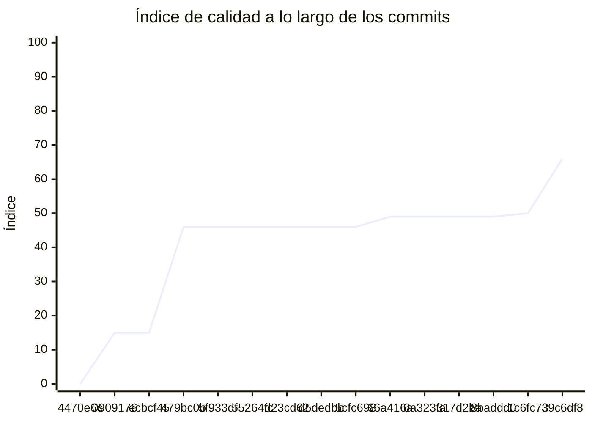

<!-- evaluacion:inicio -->
# Evaluación — Final-Programacion-II/turnos-appointments-service

> Documento **generado automáticamente** por la cátedra de Programación II (UM): RepoSense + análisis de calidad de **7 dimensiones**. **No editar a mano**: se regenera en cada evaluación.
> Rama evaluada: `main`. Análisis **heurístico** (regex + métricas) + build: es una criba para orientar la revisión, **no una nota**. La **documentación** del repositorio no se evalúa.
> Generado: 2026-11-20.

## 1. Veredicto

| Aspecto | Resultado |
|---|---|
| Índice de calidad | **77/100** |
| Tipo de repositorio | `backend` |
| Build (`mvnw verify` / `gradlew check`) | OK |
| Código (LOC) | 8,874 |
| Archivos de código | 159 |
| Clases | 188 |
| Código dentro de clases (%POO) | 78% |
| Funciones fuera de clases | 0 |
| Duplicación (puerta) | 2.3% |
| Duplicación lógica | 2.4% |
| Duplicación de boilerplate | 0.7% |
| Cobertura | 71% |
| Tope duro aplicado a D1 | `POO_BAJO` → D1 ≤ 60 |

> Este informe **describe** lo que el análisis midió con los criterios ya establecidos de la materia. No es una nota.

## 2. Semáforo de aprobación

Criterios de la cátedra (`CRITERIOS-CALIDAD.md`): **Aprobar** se juega con el perfil `estandar`; **destacar**, con el `exigente` (meta de excelencia).

| Semáforo | Resultado |
|---|---|
| Aprobar (`estandar`) | **no cumple** — 7/11 |
| Destacar (`exigente`) | **no cumple** — 5/11 |

**Para aprobar, falta cumplir:** SOLID

**Para destacar, falta cumplir:** SOLID; POO; Duplicación

## 3. Autoría (RepoSense)

| Autor | Commits | Código (LOC) | Tests (LOC) | Docs (LOC) | Días activos | % del código |
|---|---:|---:|---:|---:|---:|---:|
| Facundo Mangione | 17 | 5,385 | 5,241 | 2,503 | 17 | 100% |

> _El LOC de autoría lo calcula RepoSense sobre el historial y puede diferir del LOC de código del análisis (que mira el estado de `main`)._

## 4. Dimensiones evaluadas

Cada dimensión indica **qué mide**, **por qué importa** y **tu resultado**. Cuando el puntaje queda por debajo de la referencia, se agregan preguntas para **investigar la causa** (no hay recetas).

| Dimensión | Peso | Puntaje |
|:--|--:|--:|
| **D1** Diseño OO, SOLID y patrones (20%) | 20% | 3 |
| **D2** Arquitectura hexagonal — backend (15%) | 15% | 100 |
| **D3** Frontend KMP: MVVM y buenas prácticas (10%) | 10% | N/A |
| **D4** Integración y contrato (10%) | 10% | 90 |
| **D5** Seguridad y robustez (10%) | 10% | 100 |
| **D6** Pruebas y cobertura (20%) | 20% | 100 |
| **D7** Proceso y entrega (15%) | 15% | 100 |

### D1. Diseño OO, SOLID y patrones (20%)

- **Qué mide:** Métricas orientadas a objetos (clases, métodos, campos, cohesión, acoplamiento, herencia) y proxies de SOLID, más patrones de diseño.
- **Por qué importa:** El eje de la materia es el buen uso de la POO y su arquitectura: un diseño con clases claras y poco acopladas es más fácil de entender, probar y cambiar.
- **Tu resultado:** **3/100**
- **Para investigar la causa:**
    - ¿Se pensó el modelo de clases antes de codificar o se agrupó después?
    - ¿Qué clases concentran muchas responsabilidades a la vez?
    - ¿Los colaboradores llegan como parámetros o se crean por dentro?

### D2. Arquitectura hexagonal — backend (15%)

- **Qué mide:** Separación en capas (dominio, puertos de entrada/salida, adaptadores) y dirección de las dependencias del backend.
- **Por qué importa:** Aislar el dominio de la infraestructura permite cambiar la base de datos, el framework o el transporte sin tocar las reglas de negocio.
- **Tu resultado:** **100/100**

### D4. Integración y contrato (10%)

- **Qué mide:** Cumplimiento del contrato de integración de la cátedra (formato de errores, paginación, autenticación, endpoints esperados).
- **Por qué importa:** Los servicios deben poder integrarse entre sí y con la app sin sorpresas; el contrato es lo que hacen cumplir las pruebas de integración.
- **Tu resultado:** **90/100**

### D5. Seguridad y robustez (10%)

- **Qué mide:** Credenciales embebidas, consultas SQL por concatenación, y presencia de config de entorno; aislamiento de secretos.
- **Por qué importa:** Un secreto en el repositorio o una consulta construida por concatenación son riesgos concretos, no hipotéticos.
- **Tu resultado:** **100/100**

### D6. Pruebas y cobertura (20%)

- **Qué mide:** Cantidad y resultado de pruebas y cobertura de línea (JaCoCo/Kover, Surefire/Failsafe) cuando hay build.
- **Por qué importa:** Las pruebas son la red de seguridad para refactorizar e integrar; la cobertura acota las zonas sin verificar.
- **Tu resultado:** **100/100**

### D7. Proceso y entrega (15%)

- **Qué mide:** Artefactos verificables de proceso/entrega: `compose`, `.env.example`, CI (`.github/workflows/`), `CODEOWNERS` y wrapper de build (`mvnw`/`gradlew`). **No** puntúa documentación.
- **Por qué importa:** Un proyecto que compila, se levanta y se valida solo es más fácil de revisar y de integrar en equipo.
- **Tu resultado:** **100/100**

## 5. Señales detectadas

El análisis encontró las siguientes señales, con el archivo y la línea donde se originan cuando están disponibles:

**Archivos con más señales**

| Archivo | Señales |
|---|---:|
| `src/main/java/ar/edu/um/turnos/appointments/reservation/infrastructure/web/ReservationResource.java` | 9 |
| `src/main/java/ar/edu/um/turnos/appointments/web/rest/errors/ExceptionTranslator.java` | 9 |
| `src/main/java/ar/edu/um/turnos/appointments/reservation/domain/ReservationProcess.java` | 7 |
| `src/main/java/ar/edu/um/turnos/appointments/reservation/application/ReservationService.java` | 6 |
| `src/main/java/ar/edu/um/turnos/appointments/reservation/infrastructure/kafka/CatedraActionsListener.java` | 5 |
| `src/main/java/ar/edu/um/turnos/appointments/security/SecurityUtils.java` | 4 |
| `src/main/java/ar/edu/um/turnos/appointments/reservation/infrastructure/kafka/KafkaPhoneSubmissionPublisher.java` | 4 |
| `src/main/java/ar/edu/um/turnos/appointments/repository/entity/User.java` | 4 |
| `src/main/java/ar/edu/um/turnos/appointments/web/rest/AuthenticateController.java` | 4 |
| `src/main/java/ar/edu/um/turnos/appointments/security/DomainUserDetailsService.java` | 3 |

**DIP/concretos** (58)
- clase 'AppointmentsApp' muy acoplada (CBO=24) — `src/main/java/ar/edu/um/turnos/appointments/AppointmentsApp.java:24`
- clase 'LoggingAspect' muy acoplada (CBO=24) — `src/main/java/ar/edu/um/turnos/appointments/aop/logging/LoggingAspect.java:22`
- clase 'AsyncConfiguration' muy acoplada (CBO=12) — `src/main/java/ar/edu/um/turnos/appointments/config/AsyncConfiguration.java:22`
- clase 'AsyncConfiguration' instancia 3 concretos (CBO=12) — `src/main/java/ar/edu/um/turnos/appointments/config/AsyncConfiguration.java:22`
- clase 'CRLFLogConverter' muy acoplada (CBO=16) — `src/main/java/ar/edu/um/turnos/appointments/config/CRLFLogConverter.java:23`
- clase 'LiquibaseConfiguration' muy acoplada (CBO=18) — `src/main/java/ar/edu/um/turnos/appointments/config/LiquibaseConfiguration.java:22`
- clase 'SecurityConfiguration' muy acoplada (CBO=21) — `src/main/java/ar/edu/um/turnos/appointments/config/SecurityConfiguration.java:24`
- clase 'SecurityConfiguration' instancia 5 concretos (CBO=21) — `src/main/java/ar/edu/um/turnos/appointments/config/SecurityConfiguration.java:24`
- clase 'SecurityJwtConfiguration' muy acoplada (CBO=19) — `src/main/java/ar/edu/um/turnos/appointments/config/SecurityJwtConfiguration.java:21`
- clase 'WebConfigurer' muy acoplada (CBO=13) — `src/main/java/ar/edu/um/turnos/appointments/config/WebConfigurer.java:21`
- clase 'User' muy acoplada (CBO=12) — `src/main/java/ar/edu/um/turnos/appointments/repository/entity/User.java:23`
- clase 'AvailabilityService' muy acoplada (CBO=11) — `src/main/java/ar/edu/um/turnos/appointments/reservation/application/AvailabilityService.java:17`
- clase 'AvailabilityService' instancia 3 concretos (CBO=11) — `src/main/java/ar/edu/um/turnos/appointments/reservation/application/AvailabilityService.java:17`
- clase 'CatedraEventService' muy acoplada (CBO=14) — `src/main/java/ar/edu/um/turnos/appointments/reservation/application/CatedraEventService.java:19`
- clase 'ReconciliationService' muy acoplada (CBO=19) — `src/main/java/ar/edu/um/turnos/appointments/reservation/application/ReconciliationService.java:27`
- clase 'ReservationService' muy acoplada (CBO=46) — `src/main/java/ar/edu/um/turnos/appointments/reservation/application/ReservationService.java:33`
- clase 'ReservationService' instancia 4 concretos (CBO=46) — `src/main/java/ar/edu/um/turnos/appointments/reservation/application/ReservationService.java:33`
- clase 'Availability' muy acoplada (CBO=10) — `src/main/java/ar/edu/um/turnos/appointments/reservation/domain/Availability.java:18`
- clase 'ReservationProcess' muy acoplada (CBO=38) — `src/main/java/ar/edu/um/turnos/appointments/reservation/domain/ReservationProcess.java:17`
- clase 'ReservationProcess' instancia 4 concretos (CBO=38) — `src/main/java/ar/edu/um/turnos/appointments/reservation/domain/ReservationProcess.java:17`
- clase 'ReservationStatus' muy acoplada (CBO=14) — `src/main/java/ar/edu/um/turnos/appointments/reservation/domain/ReservationStatus.java:7`
- clase 'ReservationConfiguration' muy acoplada (CBO=19) — `src/main/java/ar/edu/um/turnos/appointments/reservation/infrastructure/ReservationConfiguration.java:27`
- clase 'ReservationConfiguration' instancia 4 concretos (CBO=19) — `src/main/java/ar/edu/um/turnos/appointments/reservation/infrastructure/ReservationConfiguration.java:27`
- clase 'CatalogRestAdapter' muy acoplada (CBO=19) — `src/main/java/ar/edu/um/turnos/appointments/reservation/infrastructure/catalog/CatalogRestAdapter.java:23`
- clase 'CatalogRestAdapter' instancia 5 concretos (CBO=19) — `src/main/java/ar/edu/um/turnos/appointments/reservation/infrastructure/catalog/CatalogRestAdapter.java:23`
- clase 'CatedraAppointmentsAdapter' muy acoplada (CBO=17) — `src/main/java/ar/edu/um/turnos/appointments/reservation/infrastructure/catedra/CatedraAppointmentsAdapter.java:26`
- clase 'CatedraHoldAdapter' muy acoplada (CBO=16) — `src/main/java/ar/edu/um/turnos/appointments/reservation/infrastructure/catedra/CatedraHoldAdapter.java:20`
- clase 'CatedraHoldAdapter' instancia 3 concretos (CBO=16) — `src/main/java/ar/edu/um/turnos/appointments/reservation/infrastructure/catedra/CatedraHoldAdapter.java:20`
- clase 'CatedraHttp' muy acoplada (CBO=14) — `src/main/java/ar/edu/um/turnos/appointments/reservation/infrastructure/catedra/CatedraHttp.java:19`
- clase 'CatedraHttp' instancia 4 concretos (CBO=14) — `src/main/java/ar/edu/um/turnos/appointments/reservation/infrastructure/catedra/CatedraHttp.java:19`
- clase 'CatedraProperties' muy acoplada (CBO=12) — `src/main/java/ar/edu/um/turnos/appointments/reservation/infrastructure/catedra/CatedraProperties.java:13`
- clase 'CatedraRestAdapter' muy acoplada (CBO=11) — `src/main/java/ar/edu/um/turnos/appointments/reservation/infrastructure/catedra/CatedraRestAdapter.java:17`
- clase 'CatedraActionsListener' muy acoplada (CBO=32) — `src/main/java/ar/edu/um/turnos/appointments/reservation/infrastructure/kafka/CatedraActionsListener.java:26`
- clase 'KafkaPhoneSubmissionPublisher' muy acoplada (CBO=19) — `src/main/java/ar/edu/um/turnos/appointments/reservation/infrastructure/kafka/KafkaPhoneSubmissionPublisher.java:20`
- clase 'KafkaPhoneSubmissionPublisher' instancia 5 concretos (CBO=19) — `src/main/java/ar/edu/um/turnos/appointments/reservation/infrastructure/kafka/KafkaPhoneSubmissionPublisher.java:20`
- clase 'JpaReservationProcessRepository' muy acoplada (CBO=27) — `src/main/java/ar/edu/um/turnos/appointments/reservation/infrastructure/persistence/JpaReservationProcessRepository.java:25`
- clase 'JpaReservationProcessRepository' instancia 7 concretos (CBO=27) — `src/main/java/ar/edu/um/turnos/appointments/reservation/infrastructure/persistence/JpaReservationProcessRepository.java:25`
- clase 'ReservationProcessEntity' muy acoplada (CBO=13) — `src/main/java/ar/edu/um/turnos/appointments/reservation/infrastructure/persistence/ReservationProcessEntity.java:25`
- clase 'ReservationProcessJpaRepository' muy acoplada (CBO=15) — `src/main/java/ar/edu/um/turnos/appointments/reservation/infrastructure/persistence/ReservationProcessJpaRepository.java:16`
- clase 'ReservationExceptionHandler' muy acoplada (CBO=28) — `src/main/java/ar/edu/um/turnos/appointments/reservation/infrastructure/web/ReservationExceptionHandler.java:27`
- clase 'ReservationResource' muy acoplada (CBO=37) — `src/main/java/ar/edu/um/turnos/appointments/reservation/infrastructure/web/ReservationResource.java:39`
- clase 'ReservationResource' instancia 3 concretos (CBO=37) — `src/main/java/ar/edu/um/turnos/appointments/reservation/infrastructure/web/ReservationResource.java:39`
- clase 'CatedraEvent' muy acoplada (CBO=13) — `src/main/java/ar/edu/um/turnos/appointments/reservation/ports/in/CatedraEvent.java:9`
- clase 'Type' muy acoplada (CBO=12) — `src/main/java/ar/edu/um/turnos/appointments/reservation/ports/in/CatedraEvent.java:18`
- clase 'ManageReservationsUseCase' muy acoplada (CBO=11) — `src/main/java/ar/edu/um/turnos/appointments/reservation/ports/in/ManageReservationsUseCase.java:14`
- clase 'ReservationProcessRepository' muy acoplada (CBO=20) — `src/main/java/ar/edu/um/turnos/appointments/reservation/ports/out/ReservationProcessRepository.java:14`
- clase 'DomainUserDetailsService' muy acoplada (CBO=21) — `src/main/java/ar/edu/um/turnos/appointments/security/DomainUserDetailsService.java:23`
- clase 'DomainUserDetailsService' instancia 5 concretos (CBO=21) — `src/main/java/ar/edu/um/turnos/appointments/security/DomainUserDetailsService.java:23`
- clase 'SecurityUtils' muy acoplada (CBO=16) — `src/main/java/ar/edu/um/turnos/appointments/security/SecurityUtils.java:18`
- clase 'UserService' muy acoplada (CBO=25) — `src/main/java/ar/edu/um/turnos/appointments/service/UserService.java:27`
- clase 'UserService' instancia 5 concretos (CBO=25) — `src/main/java/ar/edu/um/turnos/appointments/service/UserService.java:27`
- clase 'AccountResource' muy acoplada (CBO=19) — `src/main/java/ar/edu/um/turnos/appointments/web/rest/AccountResource.java:26`
- clase 'AccountResource' instancia 3 concretos (CBO=19) — `src/main/java/ar/edu/um/turnos/appointments/web/rest/AccountResource.java:26`
- clase 'AuthenticateController' muy acoplada (CBO=33) — `src/main/java/ar/edu/um/turnos/appointments/web/rest/AuthenticateController.java:37`
- clase 'AuthenticateController' instancia 3 concretos (CBO=33) — `src/main/java/ar/edu/um/turnos/appointments/web/rest/AuthenticateController.java:37`
- clase 'BadRequestAlertException' muy acoplada (CBO=8) — `src/main/java/ar/edu/um/turnos/appointments/web/rest/errors/BadRequestAlertException.java:11`
- clase 'ExceptionTranslator' muy acoplada (CBO=76) — `src/main/java/ar/edu/um/turnos/appointments/web/rest/errors/ExceptionTranslator.java:51`
- clase 'ExceptionTranslator' instancia 4 concretos (CBO=76) — `src/main/java/ar/edu/um/turnos/appointments/web/rest/errors/ExceptionTranslator.java:51`

**SRP/responsabilidad** (69)
- método 'AppointmentsApp.logApplicationStartup' de 35 líneas — `src/main/java/ar/edu/um/turnos/appointments/AppointmentsApp.java:74`
- clase 'LoggingAspect' grande (LOC=89, métodos=12, campos=1) — `src/main/java/ar/edu/um/turnos/appointments/aop/logging/LoggingAspect.java:22`
- método 'LiquibaseConfiguration.liquibase' de 50 líneas — `src/main/java/ar/edu/um/turnos/appointments/config/LiquibaseConfiguration.java:33`
- clase 'SecurityMetersService' grande (LOC=35, métodos=6, campos=8) — `src/main/java/ar/edu/um/turnos/appointments/management/SecurityMetersService.java:8`
- clase 'SecurityMetersService' con baja cohesión (27%) — `src/main/java/ar/edu/um/turnos/appointments/management/SecurityMetersService.java:8`
- clase 'AbstractAuditingEntity' con baja cohesión (14%) — `src/main/java/ar/edu/um/turnos/appointments/repository/entity/AbstractAuditingEntity.java:23`
- clase 'Authority' grande (LOC=64, métodos=10, campos=3) — `src/main/java/ar/edu/um/turnos/appointments/repository/entity/Authority.java:18`
- clase 'Authority' con baja cohesión (24%) — `src/main/java/ar/edu/um/turnos/appointments/repository/entity/Authority.java:18`
- clase 'User' grande (LOC=137, métodos=23, campos=11) — `src/main/java/ar/edu/um/turnos/appointments/repository/entity/User.java:23`
- clase 'User' con baja cohesión (10%) — `src/main/java/ar/edu/um/turnos/appointments/repository/entity/User.java:23`
- método 'CatedraEventService.apply' con complejidad 7 — `src/main/java/ar/edu/um/turnos/appointments/reservation/application/CatedraEventService.java:35`
- clase 'ReservationService' grande (LOC=157, métodos=10, campos=6) — `src/main/java/ar/edu/um/turnos/appointments/reservation/application/ReservationService.java:33`
- clase 'ReservationService' con baja cohesión (49%) — `src/main/java/ar/edu/um/turnos/appointments/reservation/application/ReservationService.java:33`
- método 'ReservationService.ReservationService' con 6 parámetros — `src/main/java/ar/edu/um/turnos/appointments/reservation/application/ReservationService.java:42`
- método 'ReservationService.start' de 33 líneas — `src/main/java/ar/edu/um/turnos/appointments/reservation/application/ReservationService.java:64`
- método 'Appointment.Appointment' con 7 parámetros — `src/main/java/ar/edu/um/turnos/appointments/reservation/domain/Appointment.java:13`
- método 'Availability.of' de 31 líneas — `src/main/java/ar/edu/um/turnos/appointments/reservation/domain/Availability.java:22`
- método 'Availability.of' con complejidad 6 — `src/main/java/ar/edu/um/turnos/appointments/reservation/domain/Availability.java:22`
- método 'ProfessionalAgenda.ProfessionalAgenda' con 8 parámetros — `src/main/java/ar/edu/um/turnos/appointments/reservation/domain/ProfessionalAgenda.java:11`
- método 'ProfessionalAgenda.Schedule' con 5 parámetros — `src/main/java/ar/edu/um/turnos/appointments/reservation/domain/ProfessionalAgenda.java:25`
- método 'Schedule.Schedule' con 5 parámetros — `src/main/java/ar/edu/um/turnos/appointments/reservation/domain/ProfessionalAgenda.java:25`
- clase 'ReservationProcess' grande (LOC=287, métodos=33, campos=15) — `src/main/java/ar/edu/um/turnos/appointments/reservation/domain/ReservationProcess.java:17`
- clase 'ReservationProcess' con baja cohesión (19%) — `src/main/java/ar/edu/um/turnos/appointments/reservation/domain/ReservationProcess.java:17`
- método 'ReservationProcess.ReservationProcess' de 31 líneas — `src/main/java/ar/edu/um/turnos/appointments/reservation/domain/ReservationProcess.java:40`
- método 'ReservationProcess.ReservationProcess' con 14 parámetros — `src/main/java/ar/edu/um/turnos/appointments/reservation/domain/ReservationProcess.java:40`
- método 'ReservationProcess.held' con 7 parámetros — `src/main/java/ar/edu/um/turnos/appointments/reservation/domain/ReservationProcess.java:75`
- método 'ReservationConfiguration.reservationService' con 6 parámetros — `src/main/java/ar/edu/um/turnos/appointments/reservation/infrastructure/ReservationConfiguration.java:44`
- método 'AgendaResponse.AgendaResponse' con 8 parámetros — `src/main/java/ar/edu/um/turnos/appointments/reservation/infrastructure/catalog/AgendaResponse.java:12`
- método 'AgendaResponse.ScheduleResponse' con 5 parámetros — `src/main/java/ar/edu/um/turnos/appointments/reservation/infrastructure/catalog/AgendaResponse.java:22`
- método 'ScheduleResponse.ScheduleResponse' con 5 parámetros — `src/main/java/ar/edu/um/turnos/appointments/reservation/infrastructure/catalog/AgendaResponse.java:22`
- clase 'CatedraAppointmentsAdapter' grande (LOC=65, métodos=12, campos=5) — `src/main/java/ar/edu/um/turnos/appointments/reservation/infrastructure/catedra/CatedraAppointmentsAdapter.java:26`
- clase 'CatedraAppointmentsAdapter' con baja cohesión (24%) — `src/main/java/ar/edu/um/turnos/appointments/reservation/infrastructure/catedra/CatedraAppointmentsAdapter.java:26`
- clase 'CatedraHoldAdapter' con baja cohesión (14%) — `src/main/java/ar/edu/um/turnos/appointments/reservation/infrastructure/catedra/CatedraHoldAdapter.java:20`
- método 'CatedraProperties.CatedraProperties' de 31 líneas — `src/main/java/ar/edu/um/turnos/appointments/reservation/infrastructure/catedra/CatedraProperties.java:13`
- método 'CatedraActionsListener.onAction' de 38 líneas — `src/main/java/ar/edu/um/turnos/appointments/reservation/infrastructure/kafka/CatedraActionsListener.java:61`
- método 'CatedraActionsListener.onAction' con complejidad 7 — `src/main/java/ar/edu/um/turnos/appointments/reservation/infrastructure/kafka/CatedraActionsListener.java:61`
- método 'CatedraActionsListener.ActionMessage' con 7 parámetros — `src/main/java/ar/edu/um/turnos/appointments/reservation/infrastructure/kafka/CatedraActionsListener.java:105`
- método 'ActionMessage.ActionMessage' con 7 parámetros — `src/main/java/ar/edu/um/turnos/appointments/reservation/infrastructure/kafka/CatedraActionsListener.java:105`
- método 'KafkaPhoneSubmissionPublisher.SubmittedMessage' con 9 parámetros — `src/main/java/ar/edu/um/turnos/appointments/reservation/infrastructure/kafka/KafkaPhoneSubmissionPublisher.java:68`
- método 'SubmittedMessage.SubmittedMessage' con 9 parámetros — `src/main/java/ar/edu/um/turnos/appointments/reservation/infrastructure/kafka/KafkaPhoneSubmissionPublisher.java:68`
- método 'AvailabilityResource.AvailabilityDTO' con 6 parámetros — `src/main/java/ar/edu/um/turnos/appointments/reservation/infrastructure/web/AvailabilityResource.java:44`
- método 'AvailabilityDTO.AvailabilityDTO' con 6 parámetros — `src/main/java/ar/edu/um/turnos/appointments/reservation/infrastructure/web/AvailabilityResource.java:44`
- clase 'ReservationExceptionHandler' grande (LOC=55, métodos=10, campos=1) — `src/main/java/ar/edu/um/turnos/appointments/reservation/infrastructure/web/ReservationExceptionHandler.java:27`
- clase 'ReservationResource' grande (LOC=145, métodos=13, campos=2) — `src/main/java/ar/edu/um/turnos/appointments/reservation/infrastructure/web/ReservationResource.java:39`
- método 'ReservationResource.StartReservationRequest' con 5 parámetros — `src/main/java/ar/edu/um/turnos/appointments/reservation/infrastructure/web/ReservationResource.java:140`
- método 'StartReservationRequest.StartReservationRequest' con 5 parámetros — `src/main/java/ar/edu/um/turnos/appointments/reservation/infrastructure/web/ReservationResource.java:140`
- método 'ReservationResource.ReservationDTO' de 33 líneas — `src/main/java/ar/edu/um/turnos/appointments/reservation/infrastructure/web/ReservationResource.java:164`
- método 'ReservationResource.ReservationDTO' con 13 parámetros — `src/main/java/ar/edu/um/turnos/appointments/reservation/infrastructure/web/ReservationResource.java:164`
- método 'ReservationDTO.ReservationDTO' de 33 líneas — `src/main/java/ar/edu/um/turnos/appointments/reservation/infrastructure/web/ReservationResource.java:164`
- método 'ReservationDTO.ReservationDTO' con 13 parámetros — `src/main/java/ar/edu/um/turnos/appointments/reservation/infrastructure/web/ReservationResource.java:164`
- método 'CatedraEvent.CatedraEvent' con 7 parámetros — `src/main/java/ar/edu/um/turnos/appointments/reservation/ports/in/CatedraEvent.java:9`
- método 'ManageReservationsUseCase.StartReservation' con 5 parámetros — `src/main/java/ar/edu/um/turnos/appointments/reservation/ports/in/ManageReservationsUseCase.java:45`
- método 'StartReservation.StartReservation' con 5 parámetros — `src/main/java/ar/edu/um/turnos/appointments/reservation/ports/in/ManageReservationsUseCase.java:45`
- método 'PhoneSubmissionPublisher.PhoneSubmission' con 6 parámetros — `src/main/java/ar/edu/um/turnos/appointments/reservation/ports/out/PhoneSubmissionPublisher.java:16`
- método 'PhoneSubmission.PhoneSubmission' con 6 parámetros — `src/main/java/ar/edu/um/turnos/appointments/reservation/ports/out/PhoneSubmissionPublisher.java:16`
- clase 'DomainUserDetailsService' con baja cohesión (11%) — `src/main/java/ar/edu/um/turnos/appointments/security/DomainUserDetailsService.java:23`
- clase 'SecurityUtils' grande (LOC=96, métodos=11, campos=3) — `src/main/java/ar/edu/um/turnos/appointments/security/SecurityUtils.java:18`
- clase 'SecurityUtils' con baja cohesión (0%) — `src/main/java/ar/edu/um/turnos/appointments/security/SecurityUtils.java:18`
- método 'AccountDTO.AccountDTO' de 33 líneas — `src/main/java/ar/edu/um/turnos/appointments/service/dto/AccountDTO.java:13`
- método 'AccountDTO.AccountDTO' con 13 parámetros — `src/main/java/ar/edu/um/turnos/appointments/service/dto/AccountDTO.java:13`
- clase 'AuthenticateController' con baja cohesión (24%) — `src/main/java/ar/edu/um/turnos/appointments/web/rest/AuthenticateController.java:37`
- clase 'ErrorConstants' grande (LOC=11, métodos=1, campos=8) — `src/main/java/ar/edu/um/turnos/appointments/web/rest/errors/ErrorConstants.java:5`
- clase 'ExceptionTranslator' grande (LOC=210, métodos=24, campos=7) — `src/main/java/ar/edu/um/turnos/appointments/web/rest/errors/ExceptionTranslator.java:51`
- clase 'ExceptionTranslator' con baja cohesión (0%) — `src/main/java/ar/edu/um/turnos/appointments/web/rest/errors/ExceptionTranslator.java:51`
- método 'ExceptionTranslator.handleExceptionInternal' con 5 parámetros — `src/main/java/ar/edu/um/turnos/appointments/web/rest/errors/ExceptionTranslator.java:79`
- método 'ExceptionTranslator.customizeProblem' con complejidad 9 — `src/main/java/ar/edu/um/turnos/appointments/web/rest/errors/ExceptionTranslator.java:111`
- método 'ExceptionTranslator.getCustomizedErrorDetails' con complejidad 8 — `src/main/java/ar/edu/um/turnos/appointments/web/rest/errors/ExceptionTranslator.java:216`
- método 'ExceptionTranslator.getMappedStatus' con complejidad 6 — `src/main/java/ar/edu/um/turnos/appointments/web/rest/errors/ExceptionTranslator.java:237`
- clase 'LoginVM' con baja cohesión (33%) — `src/main/java/ar/edu/um/turnos/appointments/web/rest/vm/LoginVM.java:9`

**OCP/type-switch** (5)
- clase 'Authority' con 1 type-checks — `src/main/java/ar/edu/um/turnos/appointments/repository/entity/Authority.java:18`
- clase 'User' con 1 type-checks — `src/main/java/ar/edu/um/turnos/appointments/repository/entity/User.java:23`
- clase 'SecurityUtils' con 6 type-checks — `src/main/java/ar/edu/um/turnos/appointments/security/SecurityUtils.java:18`
- clase 'AuthenticateController' con 1 type-checks — `src/main/java/ar/edu/um/turnos/appointments/web/rest/AuthenticateController.java:37`
- clase 'ExceptionTranslator' con 26 type-checks — `src/main/java/ar/edu/um/turnos/appointments/web/rest/errors/ExceptionTranslator.java:51`

**POO** (2)
- clase 'SecurityMetersService' con 4 campos públicos (encapsulación) — `src/main/java/ar/edu/um/turnos/appointments/management/SecurityMetersService.java:8`
- clase 'ErrorConstants' con 8 campos públicos (encapsulación) — `src/main/java/ar/edu/um/turnos/appointments/web/rest/errors/ErrorConstants.java:5`

**?** (2)
- clase 'EmailAlreadyUsedException' con herencia profunda (DIT=2) — `src/main/java/ar/edu/um/turnos/appointments/web/rest/errors/EmailAlreadyUsedException.java:6`
- clase 'LoginAlreadyUsedException' con herencia profunda (DIT=2) — `src/main/java/ar/edu/um/turnos/appointments/web/rest/errors/LoginAlreadyUsedException.java:6`

**duplicación** (6)
- duplicación lógica: 2.3% · boilerplate: 0.7%
- bloque de 8 líneas repetido 2 veces en src/test/java/ar/edu/um/turnos/appointments/reservation/application/CatedraEventServiceTest.java:34, src/test/java/ar/edu/um/turnos/appointments/reservation/domain/ReservationProcessTest.java:233 — `src/test/java/ar/edu/um/turnos/appointments/reservation/application/CatedraEventServiceTest.java:34`
- bloque de 8 líneas repetido 3 veces en src/test/java/ar/edu/um/turnos/appointments/reservation/infrastructure/catedra/CatedraAppointmentsAdapterTest.java:119, src/test/java/ar/edu/um/turnos/appointments/reservation/infrastructure/catedra/CatedraRestAdapterTest.java:80, src/test/java/ar/edu/um/turnos/appointments/reservation/infrastructure/catalog/CatalogRestAdapterTest.java:101 — `src/test/java/ar/edu/um/turnos/appointments/reservation/infrastructure/catedra/CatedraAppointmentsAdapterTest.java:119`
- bloque de 8 líneas repetido 3 veces en src/test/java/ar/edu/um/turnos/appointments/reservation/infrastructure/catedra/CatedraAppointmentsAdapterTest.java:120, src/test/java/ar/edu/um/turnos/appointments/reservation/infrastructure/catedra/CatedraRestAdapterTest.java:81, src/test/java/ar/edu/um/turnos/appointments/reservation/infrastructure/catalog/CatalogRestAdapterTest.java:102 — `src/test/java/ar/edu/um/turnos/appointments/reservation/infrastructure/catedra/CatedraAppointmentsAdapterTest.java:120`
- bloque de 8 líneas repetido 2 veces en src/test/java/ar/edu/um/turnos/appointments/reservation/infrastructure/web/AvailabilityIT.java:107, src/test/java/ar/edu/um/turnos/appointments/reservation/application/ReservationServiceTest.java:327 — `src/test/java/ar/edu/um/turnos/appointments/reservation/infrastructure/web/AvailabilityIT.java:107`
- bloque de 8 líneas repetido 3 veces en src/test/java/ar/edu/um/turnos/appointments/reservation/infrastructure/web/ReservationIT.java:107, src/test/java/ar/edu/um/turnos/appointments/reservation/infrastructure/web/AvailabilityIT.java:105, src/test/java/ar/edu/um/turnos/appointments/reservation/application/ReservationServiceTest.java:325 — `src/test/java/ar/edu/um/turnos/appointments/reservation/infrastructure/web/ReservationIT.java:107`

## 6. Evolución por commit

Métricas calculadas sobre el estado de `main` en **cada commit** (15 commits con trabajo), del primero al último. La calidad usa el perfil `exigente`; el aporte de código lo mide RepoSense. El índice puede **bajar** al crecer el proyecto: se acumulan señales.

| # | Fecha | Commit | Autor | LOC | Índice | %POO | Duplic. | Sueltas |
|---|---|---|---|---:|---:|---:|---:|---:|
| 1 | 2026-09-16 | `4470e6c` | Ing. Daniel Quinteros | 0 | 0 | 0% | 0.0% | 0 |
| 2 | 2026-09-16 | `0909176` | Ing. Daniel Quinteros | 0 | 15 | 0% | 0.0% | 0 |
| 3 | 2026-10-30 | `ecbcf45` | Facundo Mangione | 0 | 15 | 0% | 0.0% | 0 |
| 4 | 2026-11-02 | `479bc0b` | Facundo Mangione | 7,001 | 46 | 78% | 12.6% | 0 |
| 5 | 2026-11-03 | `5f933df` | Facundo Mangione | 7,610 | 46 | 77% | 12.1% | 0 |
| 6 | 2026-11-03 | `55264fc` | Facundo Mangione | 9,281 | 46 | 78% | 10.3% | 0 |
| 7 | 2026-11-03 | `d23cd62` | Facundo Mangione | 10,226 | 46 | 79% | 9.6% | 0 |
| 8 | 2026-11-05 | `d5dedbb` | Facundo Mangione | 10,846 | 46 | 79% | 9.2% | 0 |
| 9 | 2026-11-06 | `5cfc698` | Facundo Mangione | 11,167 | 46 | 79% | 8.9% | 0 |
| 10 | 2026-11-07 | `66a416a` | Facundo Mangione | 11,167 | 49 | 79% | 8.9% | 0 |
| 11 | 2026-11-08 | `0a323fa` | Facundo Mangione | 11,207 | 49 | 79% | 9.2% | 0 |
| 12 | 2026-11-09 | `317d2ba` | Facundo Mangione | 11,207 | 49 | 79% | 9.2% | 0 |
| 13 | 2026-11-15 | `8baddd0` | Facundo Mangione | 11,293 | 49 | 79% | 9.1% | 0 |
| 14 | 2026-11-17 | `1c6fc73` | Facundo Mangione | 8,874 | 50 | 78% | 2.3% | 0 |
| 15 | 2026-11-18 | `39c6df8` | Facundo Mangione | 8,874 | 66 | 78% | 2.3% | 0 |

---
_Informe generado por la cátedra. Las dimensiones y umbrales corresponden a `calidad.py` (perfil `exigente`); el semáforo, a `CRITERIOS-CALIDAD.md`. La documentación del repositorio no se evalúa. Ante dudas, revisá el archivo señalado._
<!-- evaluacion:fin -->
