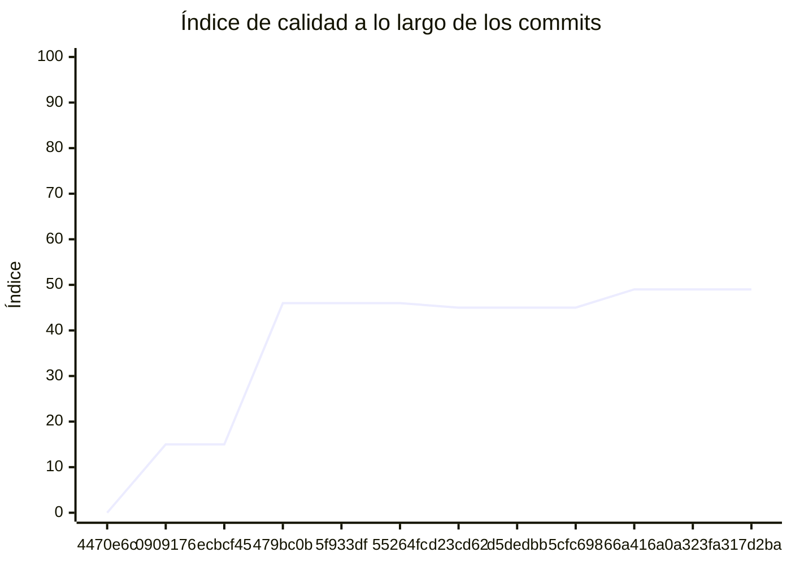

<!-- evaluacion:inicio -->
# Evaluación — Final-Programacion-II/turnos-appointments-service

> Documento **generado automáticamente** por la cátedra de Programación II (UM): RepoSense + análisis de calidad de **7 dimensiones**. **No editar a mano**: se regenera en cada evaluación.
> Rama evaluada: `main`. Análisis **heurístico** (regex + métricas) + build: es una criba para orientar la revisión, **no una nota**. La **documentación** del repositorio no se evalúa.
> Generado: 2026-11-11.

## 1. Veredicto

| Aspecto | Resultado |
|---|---|
| Índice de calidad | **60/100** |
| Tipo de repositorio | `backend` |
| Build (`mvnw verify` / `gradlew check`) | OK |
| Código (LOC) | 11,207 |
| Archivos de código | 168 |
| Clases | 196 |
| Código dentro de clases (%POO) | 83% |
| Funciones fuera de clases | 0 |
| Duplicación (puerta) | 9.2% |
| Duplicación lógica | 9.7% |
| Duplicación de boilerplate | 2.3% |
| Cobertura | 75% |

> Este informe **describe** lo que el análisis midió con los criterios ya establecidos de la materia. No es una nota.

## 2. Semáforo de aprobación

Criterios de la cátedra (`CRITERIOS-CALIDAD.md`): **Aprobar** se juega con el perfil `estandar`; **destacar**, con el `exigente` (meta de excelencia).

| Semáforo | Resultado |
|---|---|
| Aprobar (`estandar`) | **no cumple** — 5/11 |
| Destacar (`exigente`) | **no cumple** — 5/11 |

**Para aprobar, falta cumplir:** SOLID; Hexagonal; Duplicación

**Para destacar, falta cumplir:** SOLID; Hexagonal; Duplicación

## 3. Autoría (RepoSense)

| Autor | Commits | Código (LOC) | Tests (LOC) | Docs (LOC) | Días activos | % del código |
|---|---:|---:|---:|---:|---:|---:|
| Facundo Mangione | 14 | 6,575 | 6,906 | 2,403 | 12 | 100% |

> _El LOC de autoría lo calcula RepoSense sobre el historial y puede diferir del LOC de código del análisis (que mira el estado de `main`)._

## 4. Dimensiones evaluadas

Cada dimensión indica **qué mide**, **por qué importa** y **tu resultado**. Cuando el puntaje queda por debajo de la referencia, se agregan preguntas para **investigar la causa** (no hay recetas).

| Dimensión | Peso | Puntaje |
|:--|--:|--:|
| **D1** Diseño OO, SOLID y patrones (20%) | 20% | 1 |
| **D2** Arquitectura hexagonal — backend (15%) | 15% | 0 |
| **D3** Frontend KMP: MVVM y buenas prácticas (10%) | 10% | N/A |
| **D4** Integración y contrato (10%) | 10% | 90 |
| **D5** Seguridad y robustez (10%) | 10% | 100 |
| **D6** Pruebas y cobertura (20%) | 20% | 100 |
| **D7** Proceso y entrega (15%) | 15% | 100 |

### D1. Diseño OO, SOLID y patrones (20%)

- **Qué mide:** Métricas orientadas a objetos (clases, métodos, campos, cohesión, acoplamiento, herencia) y proxies de SOLID, más patrones de diseño.
- **Por qué importa:** El eje de la materia es el buen uso de la POO y su arquitectura: un diseño con clases claras y poco acopladas es más fácil de entender, probar y cambiar.
- **Tu resultado:** **1/100**
- **Para investigar la causa:**
    - ¿Se pensó el modelo de clases antes de codificar o se agrupó después?
    - ¿Qué clases concentran muchas responsabilidades a la vez?
    - ¿Los colaboradores llegan como parámetros o se crean por dentro?

### D2. Arquitectura hexagonal — backend (15%)

- **Qué mide:** Separación en capas (dominio, puertos de entrada/salida, adaptadores) y dirección de las dependencias del backend.
- **Por qué importa:** Aislar el dominio de la infraestructura permite cambiar la base de datos, el framework o el transporte sin tocar las reglas de negocio.
- **Tu resultado:** **0/100**
- **Para investigar la causa:**
    - ¿El dominio importa framework o detalles de persistencia?
    - ¿Dónde vive la lógica de negocio frente a los controladores?
    - ¿Se definieron puertos para los servicios que se consumen?

### D4. Integración y contrato (10%)

- **Qué mide:** Cumplimiento del contrato de integración de la cátedra (formato de errores, paginación, autenticación, endpoints esperados).
- **Por qué importa:** Los servicios deben poder integrarse entre sí y con la app sin sorpresas; el contrato es lo que hacen cumplir las pruebas de integración.
- **Tu resultado:** **90/100**

### D5. Seguridad y robustez (10%)

- **Qué mide:** Credenciales embebidas, consultas SQL por concatenación, y presencia de config de entorno; aislamiento de secretos.
- **Por qué importa:** Un secreto en el repositorio o una consulta construida por concatenación son riesgos concretos, no hipotéticos.
- **Tu resultado:** **100/100**

### D6. Pruebas y cobertura (20%)

- **Qué mide:** Cantidad y resultado de pruebas y cobertura de línea (JaCoCo/Kover, Surefire/Failsafe) cuando hay build.
- **Por qué importa:** Las pruebas son la red de seguridad para refactorizar e integrar; la cobertura acota las zonas sin verificar.
- **Tu resultado:** **100/100**

### D7. Proceso y entrega (15%)

- **Qué mide:** Artefactos verificables de proceso/entrega: `compose`, `.env.example`, CI (`.github/workflows/`), `CODEOWNERS` y wrapper de build (`mvnw`/`gradlew`). **No** puntúa documentación.
- **Por qué importa:** Un proyecto que compila, se levanta y se valida solo es más fácil de revisar y de integrar en equipo.
- **Tu resultado:** **100/100**

## 5. Señales detectadas

El análisis encontró las siguientes señales (archivo, sin número de línea a propósito):

**SRP/responsabilidad** (101)
- clase 'AppointmentsApp' grande (LOC=80, métodos=10, campos=2) — `src/main/java/ar/edu/um/turnos/appointments/AppointmentsApp.java`
- método 'AppointmentsApp.logApplicationStartup' de 35 líneas — `src/main/java/ar/edu/um/turnos/appointments/AppointmentsApp.java`
- clase 'DomainUserDetailsService' grande (LOC=68, métodos=10, campos=3) — `src/main/java/ar/edu/um/turnos/appointments/security/DomainUserDetailsService.java`
- clase 'DomainUserDetailsService' con baja cohesión (16%) — `src/main/java/ar/edu/um/turnos/appointments/security/DomainUserDetailsService.java`
- clase 'SecurityUtils' grande (LOC=96, métodos=12, campos=3) — `src/main/java/ar/edu/um/turnos/appointments/security/SecurityUtils.java`
- clase 'SecurityUtils' con baja cohesión (2%) — `src/main/java/ar/edu/um/turnos/appointments/security/SecurityUtils.java`
- clase 'LoggingAspect' grande (LOC=89, métodos=11, campos=1) — `src/main/java/ar/edu/um/turnos/appointments/aop/logging/LoggingAspect.java`
- método 'CatedraProperties.CatedraProperties' de 31 líneas — `src/main/java/ar/edu/um/turnos/appointments/reservation/infrastructure/catedra/CatedraProperties.java`
- clase 'CatedraHoldAdapter' con baja cohesión (14%) — `src/main/java/ar/edu/um/turnos/appointments/reservation/infrastructure/catedra/CatedraHoldAdapter.java`
- clase 'CatedraAppointmentsAdapter' grande (LOC=65, métodos=12, campos=5) — `src/main/java/ar/edu/um/turnos/appointments/reservation/infrastructure/catedra/CatedraAppointmentsAdapter.java`
- clase 'CatedraAppointmentsAdapter' con baja cohesión (20%) — `src/main/java/ar/edu/um/turnos/appointments/reservation/infrastructure/catedra/CatedraAppointmentsAdapter.java`
- método 'CatedraActionsListener.onAction' de 38 líneas — `src/main/java/ar/edu/um/turnos/appointments/reservation/infrastructure/kafka/CatedraActionsListener.java`
- método 'CatedraActionsListener.onAction' con complejidad 7 — `src/main/java/ar/edu/um/turnos/appointments/reservation/infrastructure/kafka/CatedraActionsListener.java`
- método 'AgendaResponse.ScheduleResponse' con 5 parámetros — `src/main/java/ar/edu/um/turnos/appointments/reservation/infrastructure/catalog/AgendaResponse.java`
- método 'ScheduleResponse.ScheduleResponse' con 5 parámetros — `src/main/java/ar/edu/um/turnos/appointments/reservation/infrastructure/catalog/AgendaResponse.java`
- clase 'ReservationResource' grande (LOC=145, métodos=10, campos=2) — `src/main/java/ar/edu/um/turnos/appointments/reservation/infrastructure/web/ReservationResource.java`
- clase 'ReservationExceptionHandler' grande (LOC=55, métodos=10, campos=1) — `src/main/java/ar/edu/um/turnos/appointments/reservation/infrastructure/web/ReservationExceptionHandler.java`
- método 'CatedraEventService.apply' con complejidad 7 — `src/main/java/ar/edu/um/turnos/appointments/reservation/application/CatedraEventService.java`
- clase 'ReservationService' grande (LOC=161, métodos=10, campos=6) — `src/main/java/ar/edu/um/turnos/appointments/reservation/application/ReservationService.java`
- clase 'ReservationService' con baja cohesión (47%) — `src/main/java/ar/edu/um/turnos/appointments/reservation/application/ReservationService.java`
- método 'ReservationService.start' de 33 líneas — `src/main/java/ar/edu/um/turnos/appointments/reservation/application/ReservationService.java`
- clase 'ReconciliationService' con baja cohesión (29%) — `src/main/java/ar/edu/um/turnos/appointments/reservation/application/ReconciliationService.java`
- clase 'ReservationProcess' grande (LOC=287, métodos=31, campos=15) — `src/main/java/ar/edu/um/turnos/appointments/reservation/domain/ReservationProcess.java`
- clase 'ReservationProcess' con baja cohesión (14%) — `src/main/java/ar/edu/um/turnos/appointments/reservation/domain/ReservationProcess.java`
- método 'Availability.of' de 31 líneas — `src/main/java/ar/edu/um/turnos/appointments/reservation/domain/Availability.java`
- método 'Availability.of' con complejidad 6 — `src/main/java/ar/edu/um/turnos/appointments/reservation/domain/Availability.java`
- método 'ProfessionalAgenda.Schedule' con 5 parámetros — `src/main/java/ar/edu/um/turnos/appointments/reservation/domain/ProfessionalAgenda.java`
- método 'Schedule.Schedule' con 5 parámetros — `src/main/java/ar/edu/um/turnos/appointments/reservation/domain/ProfessionalAgenda.java`
- clase 'UserService' grande (LOC=236, métodos=33, campos=4) — `src/main/java/ar/edu/um/turnos/appointments/service/UserService.java`
- método 'UserService.registerUser' de 35 líneas — `src/main/java/ar/edu/um/turnos/appointments/service/UserService.java`
- método 'UserService.createUser' de 33 líneas — `src/main/java/ar/edu/um/turnos/appointments/service/UserService.java`
- método 'UserService.updateUser' con 5 parámetros — `src/main/java/ar/edu/um/turnos/appointments/service/UserService.java`
- clase 'MailService' con baja cohesión (48%) — `src/main/java/ar/edu/um/turnos/appointments/service/MailService.java`
- método 'MailService.sendEmail' con 5 parámetros — `src/main/java/ar/edu/um/turnos/appointments/service/MailService.java`
- método 'MailService.sendEmailSync' con 5 parámetros — `src/main/java/ar/edu/um/turnos/appointments/service/MailService.java`
- clase 'UserMapper' grande (LOC=112, métodos=13, campos=0) — `src/main/java/ar/edu/um/turnos/appointments/service/mapper/UserMapper.java`
- clase 'PasswordChangeDTO' con baja cohesión (40%) — `src/main/java/ar/edu/um/turnos/appointments/service/dto/PasswordChangeDTO.java`
- clase 'AdminUserDTO' grande (LOC=140, métodos=29, campos=14) — `src/main/java/ar/edu/um/turnos/appointments/service/dto/AdminUserDTO.java`
- clase 'AdminUserDTO' con baja cohesión (16%) — `src/main/java/ar/edu/um/turnos/appointments/service/dto/AdminUserDTO.java`
- clase 'UserDTO' con baja cohesión (31%) — `src/main/java/ar/edu/um/turnos/appointments/service/dto/UserDTO.java`
- clase 'SecurityMetersService' grande (LOC=35, métodos=7, campos=8) — `src/main/java/ar/edu/um/turnos/appointments/management/SecurityMetersService.java`
- clase 'SecurityMetersService' con baja cohesión (33%) — `src/main/java/ar/edu/um/turnos/appointments/management/SecurityMetersService.java`
- método 'SecurityConfiguration.filterChain' de 30 líneas — `src/main/java/ar/edu/um/turnos/appointments/config/SecurityConfiguration.java`
- clase 'Authority' grande (LOC=64, métodos=10, campos=3) — `src/main/java/ar/edu/um/turnos/appointments/domain/Authority.java`
- clase 'Authority' con baja cohesión (24%) — `src/main/java/ar/edu/um/turnos/appointments/domain/Authority.java`
- clase 'AbstractAuditingEntity' con baja cohesión (14%) — `src/main/java/ar/edu/um/turnos/appointments/domain/AbstractAuditingEntity.java`
- clase 'User' grande (LOC=166, métodos=29, campos=14) — `src/main/java/ar/edu/um/turnos/appointments/domain/User.java`
- clase 'User' con baja cohesión (8%) — `src/main/java/ar/edu/um/turnos/appointments/domain/User.java`
- clase 'AuthenticateController' con baja cohesión (14%) — `src/main/java/ar/edu/um/turnos/appointments/web/rest/AuthenticateController.java`
- clase 'AccountResource' grande (LOC=156, métodos=10, campos=5) — `src/main/java/ar/edu/um/turnos/appointments/web/rest/AccountResource.java`
- clase 'AccountResource' con baja cohesión (49%) — `src/main/java/ar/edu/um/turnos/appointments/web/rest/AccountResource.java`
- clase 'ErrorConstants' grande (LOC=11, métodos=1, campos=8) — `src/main/java/ar/edu/um/turnos/appointments/web/rest/errors/ErrorConstants.java`
- clase 'ExceptionTranslator' grande (LOC=208, métodos=24, campos=7) — `src/main/java/ar/edu/um/turnos/appointments/web/rest/errors/ExceptionTranslator.java`
- clase 'ExceptionTranslator' con baja cohesión (0%) — `src/main/java/ar/edu/um/turnos/appointments/web/rest/errors/ExceptionTranslator.java`
- método 'ExceptionTranslator.customizeProblem' con complejidad 9 — `src/main/java/ar/edu/um/turnos/appointments/web/rest/errors/ExceptionTranslator.java`
- método 'ExceptionTranslator.getCustomizedErrorDetails' con complejidad 8 — `src/main/java/ar/edu/um/turnos/appointments/web/rest/errors/ExceptionTranslator.java`
- clase 'ManagedUserVM' con baja cohesión (17%) — `src/main/java/ar/edu/um/turnos/appointments/web/rest/vm/ManagedUserVM.java`
- clase 'LoginVM' con baja cohesión (33%) — `src/main/java/ar/edu/um/turnos/appointments/web/rest/vm/LoginVM.java`
- clase 'DomainUserDetailsServiceIT' grande (LOC=96, métodos=11, campos=9) — `src/test/java/ar/edu/um/turnos/appointments/security/DomainUserDetailsServiceIT.java`
- clase 'SecurityUtilsUnitTest' grande (LOC=93, métodos=10, campos=0) — `src/test/java/ar/edu/um/turnos/appointments/security/SecurityUtilsUnitTest.java`
- clase 'JwtAuthenticationTestUtils' grande (LOC=57, métodos=10, campos=1) — `src/test/java/ar/edu/um/turnos/appointments/security/jwt/JwtAuthenticationTestUtils.java`
- clase 'TokenAuthenticationSecurityMetersIT' con baja cohesión (48%) — `src/test/java/ar/edu/um/turnos/appointments/security/jwt/TokenAuthenticationSecurityMetersIT.java`
- clase 'CatedraAppointmentsAdapterTest' grande (LOC=95, métodos=11, campos=6) — `src/test/java/ar/edu/um/turnos/appointments/reservation/infrastructure/catedra/CatedraAppointmentsAdapterTest.java`
- clase 'CatedraAppointmentsAdapterTest' con baja cohesión (25%) — `src/test/java/ar/edu/um/turnos/appointments/reservation/infrastructure/catedra/CatedraAppointmentsAdapterTest.java`
- clase 'CatedraHoldAdapterTest' grande (LOC=115, métodos=12, campos=8) — `src/test/java/ar/edu/um/turnos/appointments/reservation/infrastructure/catedra/CatedraHoldAdapterTest.java`
- clase 'CatedraHoldAdapterTest' con baja cohesión (9%) — `src/test/java/ar/edu/um/turnos/appointments/reservation/infrastructure/catedra/CatedraHoldAdapterTest.java`
- clase 'CatedraRestAdapterTest' con baja cohesión (38%) — `src/test/java/ar/edu/um/turnos/appointments/reservation/infrastructure/catedra/CatedraRestAdapterTest.java`
- clase 'CatalogRestAdapterTest' grande (LOC=77, métodos=10, campos=3) — `src/test/java/ar/edu/um/turnos/appointments/reservation/infrastructure/catalog/CatalogRestAdapterTest.java`
- clase 'CatalogRestAdapterTest' con baja cohesión (18%) — `src/test/java/ar/edu/um/turnos/appointments/reservation/infrastructure/catalog/CatalogRestAdapterTest.java`
- clase 'ReservationIT' grande (LOC=321, métodos=23, campos=14) — `src/test/java/ar/edu/um/turnos/appointments/reservation/infrastructure/web/ReservationIT.java`
- método 'ReservationIT.flujoCompletoConTelefonoYConfirmacion' de 31 líneas — `src/test/java/ar/edu/um/turnos/appointments/reservation/infrastructure/web/ReservationIT.java`
- clase 'ReconciliationServiceTest' grande (LOC=112, métodos=12, campos=7) — `src/test/java/ar/edu/um/turnos/appointments/reservation/application/ReconciliationServiceTest.java`
- clase 'ReconciliationServiceTest' con baja cohesión (42%) — `src/test/java/ar/edu/um/turnos/appointments/reservation/application/ReconciliationServiceTest.java`
- clase 'CatedraEventServiceTest' grande (LOC=102, métodos=10, campos=6) — `src/test/java/ar/edu/um/turnos/appointments/reservation/application/CatedraEventServiceTest.java`
- método 'CatedraEventServiceTest.evento' con complejidad 7 — `src/test/java/ar/edu/um/turnos/appointments/reservation/application/CatedraEventServiceTest.java`
- clase 'InMemoryReservationProcesses' grande (LOC=90, métodos=10, campos=3) — `src/test/java/ar/edu/um/turnos/appointments/reservation/application/InMemoryReservationProcesses.java`
- clase 'InMemoryReservationProcesses' con baja cohesión (47%) — `src/test/java/ar/edu/um/turnos/appointments/reservation/application/InMemoryReservationProcesses.java`
- clase 'ReservationServiceTest' grande (LOC=268, métodos=31, campos=12) — `src/test/java/ar/edu/um/turnos/appointments/reservation/application/ReservationServiceTest.java`
- clase 'AvailabilityTest' grande (LOC=80, métodos=11, campos=3) — `src/test/java/ar/edu/um/turnos/appointments/reservation/domain/AvailabilityTest.java`
- clase 'AvailabilityTest' con baja cohesión (38%) — `src/test/java/ar/edu/um/turnos/appointments/reservation/domain/AvailabilityTest.java`
- clase 'ReservationProcessTest' grande (LOC=185, métodos=20, campos=3) — `src/test/java/ar/edu/um/turnos/appointments/reservation/domain/ReservationProcessTest.java`
- clase 'DateTimeWrapper' grande (LOC=96, métodos=19, campos=9) — `src/test/java/ar/edu/um/turnos/appointments/repository/timezone/DateTimeWrapper.java`
- clase 'DateTimeWrapper' con baja cohesión (11%) — `src/test/java/ar/edu/um/turnos/appointments/repository/timezone/DateTimeWrapper.java`
- clase 'MailServiceIT' grande (LOC=176, métodos=12, campos=7) — `src/test/java/ar/edu/um/turnos/appointments/service/MailServiceIT.java`
- clase 'UserServiceIT' grande (LOC=136, métodos=9, campos=12) — `src/test/java/ar/edu/um/turnos/appointments/service/UserServiceIT.java`
- clase 'UserMapperTest' grande (LOC=129, métodos=11, campos=5) — `src/test/java/ar/edu/um/turnos/appointments/service/mapper/UserMapperTest.java`
- clase 'HibernateTimeZoneIT' grande (LOC=114, métodos=10, campos=8) — `src/test/java/ar/edu/um/turnos/appointments/config/timezone/HibernateTimeZoneIT.java`
- clase 'AuthorityResourceIT' grande (LOC=142, métodos=17, campos=8) — `src/test/java/ar/edu/um/turnos/appointments/web/rest/AuthorityResourceIT.java`
- clase 'AuthorityResourceIT' con baja cohesión (29%) — `src/test/java/ar/edu/um/turnos/appointments/web/rest/AuthorityResourceIT.java`
- clase 'UserResourceIT' grande (LOC=385, métodos=20, campos=21) — `src/test/java/ar/edu/um/turnos/appointments/web/rest/UserResourceIT.java`
- método 'UserResourceIT.updateUser' de 38 líneas — `src/test/java/ar/edu/um/turnos/appointments/web/rest/UserResourceIT.java`
- método 'UserResourceIT.updateUserLogin' de 39 líneas — `src/test/java/ar/edu/um/turnos/appointments/web/rest/UserResourceIT.java`
- método 'UserResourceIT.updateUserExistingEmail' de 33 líneas — `src/test/java/ar/edu/um/turnos/appointments/web/rest/UserResourceIT.java`
- método 'UserResourceIT.updateUserExistingLogin' de 33 líneas — `src/test/java/ar/edu/um/turnos/appointments/web/rest/UserResourceIT.java`
- clase 'AccountResourceIT' grande (LOC=567, métodos=33, campos=8) — `src/test/java/ar/edu/um/turnos/appointments/web/rest/AccountResourceIT.java`
- método 'AccountResourceIT.testSaveAccount' de 30 líneas — `src/test/java/ar/edu/um/turnos/appointments/web/rest/AccountResourceIT.java`
- método 'AccountResourceIT.testSaveExistingEmail' de 30 líneas — `src/test/java/ar/edu/um/turnos/appointments/web/rest/AccountResourceIT.java`
- clase 'TestUtil' grande (LOC=145, métodos=15, campos=2) — `src/test/java/ar/edu/um/turnos/appointments/web/rest/TestUtil.java`
- método 'TestUtil.asDecimal' con complejidad 7 — `src/test/java/ar/edu/um/turnos/appointments/web/rest/TestUtil.java`
- método 'NumberMatcher.asDecimal' con complejidad 7 — `src/test/java/ar/edu/um/turnos/appointments/web/rest/TestUtil.java`
- clase 'ExceptionTranslatorTestController' grande (LOC=47, métodos=10, campos=1) — `src/test/java/ar/edu/um/turnos/appointments/web/rest/errors/ExceptionTranslatorTestController.java`

**DIP/concretos** (122)
- clase 'AppointmentsApp' muy acoplada (CBO=24) — `src/main/java/ar/edu/um/turnos/appointments/AppointmentsApp.java`
- clase 'DomainUserDetailsService' muy acoplada (CBO=21) — `src/main/java/ar/edu/um/turnos/appointments/security/DomainUserDetailsService.java`
- clase 'DomainUserDetailsService' instancia 5 concretos (CBO=21) — `src/main/java/ar/edu/um/turnos/appointments/security/DomainUserDetailsService.java`
- clase 'SecurityUtils' muy acoplada (CBO=16) — `src/main/java/ar/edu/um/turnos/appointments/security/SecurityUtils.java`
- clase 'LoggingAspect' muy acoplada (CBO=24) — `src/main/java/ar/edu/um/turnos/appointments/aop/logging/LoggingAspect.java`
- clase 'ReservationProcessRepository' muy acoplada (CBO=20) — `src/main/java/ar/edu/um/turnos/appointments/reservation/ports/out/ReservationProcessRepository.java`
- clase 'ReservationConfiguration' muy acoplada (CBO=18) — `src/main/java/ar/edu/um/turnos/appointments/reservation/infrastructure/ReservationConfiguration.java`
- clase 'ReservationConfiguration' instancia 4 concretos (CBO=18) — `src/main/java/ar/edu/um/turnos/appointments/reservation/infrastructure/ReservationConfiguration.java`
- clase 'CatedraProperties' muy acoplada (CBO=12) — `src/main/java/ar/edu/um/turnos/appointments/reservation/infrastructure/catedra/CatedraProperties.java`
- clase 'CatedraHoldAdapter' muy acoplada (CBO=16) — `src/main/java/ar/edu/um/turnos/appointments/reservation/infrastructure/catedra/CatedraHoldAdapter.java`
- clase 'CatedraHoldAdapter' instancia 3 concretos (CBO=16) — `src/main/java/ar/edu/um/turnos/appointments/reservation/infrastructure/catedra/CatedraHoldAdapter.java`
- clase 'CatedraRestAdapter' muy acoplada (CBO=11) — `src/main/java/ar/edu/um/turnos/appointments/reservation/infrastructure/catedra/CatedraRestAdapter.java`
- clase 'CatedraAppointmentsAdapter' muy acoplada (CBO=17) — `src/main/java/ar/edu/um/turnos/appointments/reservation/infrastructure/catedra/CatedraAppointmentsAdapter.java`
- clase 'CatedraHttp' muy acoplada (CBO=14) — `src/main/java/ar/edu/um/turnos/appointments/reservation/infrastructure/catedra/CatedraHttp.java`
- clase 'CatedraHttp' instancia 4 concretos (CBO=14) — `src/main/java/ar/edu/um/turnos/appointments/reservation/infrastructure/catedra/CatedraHttp.java`
- clase 'CatedraActionsListener' muy acoplada (CBO=32) — `src/main/java/ar/edu/um/turnos/appointments/reservation/infrastructure/kafka/CatedraActionsListener.java`
- clase 'KafkaPhoneSubmissionPublisher' muy acoplada (CBO=19) — `src/main/java/ar/edu/um/turnos/appointments/reservation/infrastructure/kafka/KafkaPhoneSubmissionPublisher.java`
- clase 'KafkaPhoneSubmissionPublisher' instancia 5 concretos (CBO=19) — `src/main/java/ar/edu/um/turnos/appointments/reservation/infrastructure/kafka/KafkaPhoneSubmissionPublisher.java`
- clase 'ReservationProcessJpaRepository' muy acoplada (CBO=15) — `src/main/java/ar/edu/um/turnos/appointments/reservation/infrastructure/persistence/ReservationProcessJpaRepository.java`
- clase 'ReservationProcessEntity' muy acoplada (CBO=13) — `src/main/java/ar/edu/um/turnos/appointments/reservation/infrastructure/persistence/ReservationProcessEntity.java`
- clase 'JpaReservationProcessRepository' muy acoplada (CBO=27) — `src/main/java/ar/edu/um/turnos/appointments/reservation/infrastructure/persistence/JpaReservationProcessRepository.java`
- clase 'JpaReservationProcessRepository' instancia 7 concretos (CBO=27) — `src/main/java/ar/edu/um/turnos/appointments/reservation/infrastructure/persistence/JpaReservationProcessRepository.java`
- clase 'CatalogRestAdapter' muy acoplada (CBO=19) — `src/main/java/ar/edu/um/turnos/appointments/reservation/infrastructure/catalog/CatalogRestAdapter.java`
- clase 'CatalogRestAdapter' instancia 5 concretos (CBO=19) — `src/main/java/ar/edu/um/turnos/appointments/reservation/infrastructure/catalog/CatalogRestAdapter.java`
- clase 'ReservationResource' muy acoplada (CBO=37) — `src/main/java/ar/edu/um/turnos/appointments/reservation/infrastructure/web/ReservationResource.java`
- clase 'ReservationResource' instancia 3 concretos (CBO=37) — `src/main/java/ar/edu/um/turnos/appointments/reservation/infrastructure/web/ReservationResource.java`
- clase 'ReservationExceptionHandler' muy acoplada (CBO=28) — `src/main/java/ar/edu/um/turnos/appointments/reservation/infrastructure/web/ReservationExceptionHandler.java`
- clase 'CatedraEventService' muy acoplada (CBO=13) — `src/main/java/ar/edu/um/turnos/appointments/reservation/application/CatedraEventService.java`
- clase 'ReservationService' muy acoplada (CBO=47) — `src/main/java/ar/edu/um/turnos/appointments/reservation/application/ReservationService.java`
- clase 'ReservationService' instancia 4 concretos (CBO=47) — `src/main/java/ar/edu/um/turnos/appointments/reservation/application/ReservationService.java`
- clase 'AvailabilityService' muy acoplada (CBO=9) — `src/main/java/ar/edu/um/turnos/appointments/reservation/application/AvailabilityService.java`
- clase 'AvailabilityService' instancia 3 concretos (CBO=9) — `src/main/java/ar/edu/um/turnos/appointments/reservation/application/AvailabilityService.java`
- clase 'CatedraEvent' muy acoplada (CBO=13) — `src/main/java/ar/edu/um/turnos/appointments/reservation/application/CatedraEvent.java`
- clase 'Type' muy acoplada (CBO=12) — `src/main/java/ar/edu/um/turnos/appointments/reservation/application/CatedraEvent.java`
- clase 'ReconciliationService' muy acoplada (CBO=18) — `src/main/java/ar/edu/um/turnos/appointments/reservation/application/ReconciliationService.java`
- clase 'ReservationProcess' muy acoplada (CBO=38) — `src/main/java/ar/edu/um/turnos/appointments/reservation/domain/ReservationProcess.java`
- clase 'ReservationProcess' instancia 4 concretos (CBO=38) — `src/main/java/ar/edu/um/turnos/appointments/reservation/domain/ReservationProcess.java`
- clase 'Availability' muy acoplada (CBO=10) — `src/main/java/ar/edu/um/turnos/appointments/reservation/domain/Availability.java`
- clase 'ReservationStatus' muy acoplada (CBO=14) — `src/main/java/ar/edu/um/turnos/appointments/reservation/domain/ReservationStatus.java`
- clase 'UserService' muy acoplada (CBO=38) — `src/main/java/ar/edu/um/turnos/appointments/service/UserService.java`
- clase 'UserService' instancia 5 concretos (CBO=38) — `src/main/java/ar/edu/um/turnos/appointments/service/UserService.java`
- clase 'MailService' muy acoplada (CBO=21) — `src/main/java/ar/edu/um/turnos/appointments/service/MailService.java`
- clase 'AdminUserDTO' muy acoplada (CBO=8) — `src/main/java/ar/edu/um/turnos/appointments/service/dto/AdminUserDTO.java`
- clase 'WebConfigurer' muy acoplada (CBO=13) — `src/main/java/ar/edu/um/turnos/appointments/config/WebConfigurer.java`
- clase 'LiquibaseConfiguration' muy acoplada (CBO=18) — `src/main/java/ar/edu/um/turnos/appointments/config/LiquibaseConfiguration.java`
- clase 'CRLFLogConverter' muy acoplada (CBO=16) — `src/main/java/ar/edu/um/turnos/appointments/config/CRLFLogConverter.java`
- clase 'SecurityJwtConfiguration' muy acoplada (CBO=19) — `src/main/java/ar/edu/um/turnos/appointments/config/SecurityJwtConfiguration.java`
- clase 'SecurityConfiguration' muy acoplada (CBO=21) — `src/main/java/ar/edu/um/turnos/appointments/config/SecurityConfiguration.java`
- clase 'SecurityConfiguration' instancia 5 concretos (CBO=21) — `src/main/java/ar/edu/um/turnos/appointments/config/SecurityConfiguration.java`
- clase 'AsyncConfiguration' muy acoplada (CBO=12) — `src/main/java/ar/edu/um/turnos/appointments/config/AsyncConfiguration.java`
- clase 'AsyncConfiguration' instancia 3 concretos (CBO=12) — `src/main/java/ar/edu/um/turnos/appointments/config/AsyncConfiguration.java`
- clase 'User' muy acoplada (CBO=13) — `src/main/java/ar/edu/um/turnos/appointments/domain/User.java`
- clase 'AuthorityResource' muy acoplada (CBO=26) — `src/main/java/ar/edu/um/turnos/appointments/web/rest/AuthorityResource.java`
- clase 'AuthenticateController' muy acoplada (CBO=33) — `src/main/java/ar/edu/um/turnos/appointments/web/rest/AuthenticateController.java`
- clase 'AuthenticateController' instancia 3 concretos (CBO=33) — `src/main/java/ar/edu/um/turnos/appointments/web/rest/AuthenticateController.java`
- clase 'PublicUserResource' muy acoplada (CBO=18) — `src/main/java/ar/edu/um/turnos/appointments/web/rest/PublicUserResource.java`
- clase 'AccountResource' muy acoplada (CBO=39) — `src/main/java/ar/edu/um/turnos/appointments/web/rest/AccountResource.java`
- clase 'AccountResource' instancia 9 concretos (CBO=39) — `src/main/java/ar/edu/um/turnos/appointments/web/rest/AccountResource.java`
- clase 'UserResource' muy acoplada (CBO=46) — `src/main/java/ar/edu/um/turnos/appointments/web/rest/UserResource.java`
- clase 'UserResource' instancia 6 concretos (CBO=46) — `src/main/java/ar/edu/um/turnos/appointments/web/rest/UserResource.java`
- clase 'BadRequestAlertException' muy acoplada (CBO=8) — `src/main/java/ar/edu/um/turnos/appointments/web/rest/errors/BadRequestAlertException.java`
- clase 'ExceptionTranslator' muy acoplada (CBO=74) — `src/main/java/ar/edu/um/turnos/appointments/web/rest/errors/ExceptionTranslator.java`
- clase 'ExceptionTranslator' instancia 4 concretos (CBO=74) — `src/main/java/ar/edu/um/turnos/appointments/web/rest/errors/ExceptionTranslator.java`
- clase 'TechnicalStructureTest' muy acoplada (CBO=12) — `src/test/java/ar/edu/um/turnos/appointments/TechnicalStructureTest.java`
- clase 'DomainUserDetailsServiceIT' muy acoplada (CBO=9) — `src/test/java/ar/edu/um/turnos/appointments/security/DomainUserDetailsServiceIT.java`
- clase 'DomainUserDetailsServiceIT' instancia 3 concretos (CBO=9) — `src/test/java/ar/edu/um/turnos/appointments/security/DomainUserDetailsServiceIT.java`
- clase 'SecurityUtilsUnitTest' muy acoplada (CBO=13) — `src/test/java/ar/edu/um/turnos/appointments/security/SecurityUtilsUnitTest.java`
- clase 'SecurityUtilsUnitTest' instancia 13 concretos (CBO=13) — `src/test/java/ar/edu/um/turnos/appointments/security/SecurityUtilsUnitTest.java`
- clase 'JwtAuthenticationTestUtils' muy acoplada (CBO=20) — `src/test/java/ar/edu/um/turnos/appointments/security/jwt/JwtAuthenticationTestUtils.java`
- clase 'JwtAuthenticationTestUtils' instancia 4 concretos (CBO=20) — `src/test/java/ar/edu/um/turnos/appointments/security/jwt/JwtAuthenticationTestUtils.java`
- clase 'CatedraAppointmentsAdapterTest' muy acoplada (CBO=27) — `src/test/java/ar/edu/um/turnos/appointments/reservation/infrastructure/catedra/CatedraAppointmentsAdapterTest.java`
- clase 'CatedraAppointmentsAdapterTest' instancia 4 concretos (CBO=27) — `src/test/java/ar/edu/um/turnos/appointments/reservation/infrastructure/catedra/CatedraAppointmentsAdapterTest.java`
- clase 'CatedraHoldAdapterTest' muy acoplada (CBO=32) — `src/test/java/ar/edu/um/turnos/appointments/reservation/infrastructure/catedra/CatedraHoldAdapterTest.java`
- clase 'CatedraHoldAdapterTest' instancia 10 concretos (CBO=32) — `src/test/java/ar/edu/um/turnos/appointments/reservation/infrastructure/catedra/CatedraHoldAdapterTest.java`
- clase 'CatedraRestAdapterTest' muy acoplada (CBO=22) — `src/test/java/ar/edu/um/turnos/appointments/reservation/infrastructure/catedra/CatedraRestAdapterTest.java`
- clase 'CatedraRestAdapterTest' instancia 5 concretos (CBO=22) — `src/test/java/ar/edu/um/turnos/appointments/reservation/infrastructure/catedra/CatedraRestAdapterTest.java`
- clase 'CatedraActionsListenerTest' muy acoplada (CBO=26) — `src/test/java/ar/edu/um/turnos/appointments/reservation/infrastructure/kafka/CatedraActionsListenerTest.java`
- clase 'KafkaPhoneSubmissionPublisherTest' muy acoplada (CBO=14) — `src/test/java/ar/edu/um/turnos/appointments/reservation/infrastructure/kafka/KafkaPhoneSubmissionPublisherTest.java`
- clase 'KafkaPhoneSubmissionPublisherTest' instancia 3 concretos (CBO=14) — `src/test/java/ar/edu/um/turnos/appointments/reservation/infrastructure/kafka/KafkaPhoneSubmissionPublisherTest.java`
- clase 'CatalogRestAdapterTest' muy acoplada (CBO=28) — `src/test/java/ar/edu/um/turnos/appointments/reservation/infrastructure/catalog/CatalogRestAdapterTest.java`
- clase 'CatalogRestAdapterTest' instancia 8 concretos (CBO=28) — `src/test/java/ar/edu/um/turnos/appointments/reservation/infrastructure/catalog/CatalogRestAdapterTest.java`
- clase 'ReservationIT' muy acoplada (CBO=77) — `src/test/java/ar/edu/um/turnos/appointments/reservation/infrastructure/web/ReservationIT.java`
- clase 'ReservationIT' instancia 6 concretos (CBO=77) — `src/test/java/ar/edu/um/turnos/appointments/reservation/infrastructure/web/ReservationIT.java`
- clase 'AvailabilityIT' muy acoplada (CBO=26) — `src/test/java/ar/edu/um/turnos/appointments/reservation/infrastructure/web/AvailabilityIT.java`
- clase 'AvailabilityIT' instancia 4 concretos (CBO=26) — `src/test/java/ar/edu/um/turnos/appointments/reservation/infrastructure/web/AvailabilityIT.java`
- clase 'ReconciliationServiceTest' muy acoplada (CBO=30) — `src/test/java/ar/edu/um/turnos/appointments/reservation/application/ReconciliationServiceTest.java`
- clase 'ReconciliationServiceTest' instancia 8 concretos (CBO=30) — `src/test/java/ar/edu/um/turnos/appointments/reservation/application/ReconciliationServiceTest.java`
- clase 'CatedraEventServiceTest' muy acoplada (CBO=35) — `src/test/java/ar/edu/um/turnos/appointments/reservation/application/CatedraEventServiceTest.java`
- clase 'CatedraEventServiceTest' instancia 11 concretos (CBO=35) — `src/test/java/ar/edu/um/turnos/appointments/reservation/application/CatedraEventServiceTest.java`
- clase 'InMemoryReservationProcesses' muy acoplada (CBO=12) — `src/test/java/ar/edu/um/turnos/appointments/reservation/application/InMemoryReservationProcesses.java`
- clase 'InMemoryReservationProcesses' instancia 3 concretos (CBO=12) — `src/test/java/ar/edu/um/turnos/appointments/reservation/application/InMemoryReservationProcesses.java`
- clase 'ReservationServiceTest' muy acoplada (CBO=61) — `src/test/java/ar/edu/um/turnos/appointments/reservation/application/ReservationServiceTest.java`
- clase 'ReservationServiceTest' instancia 15 concretos (CBO=61) — `src/test/java/ar/edu/um/turnos/appointments/reservation/application/ReservationServiceTest.java`
- clase 'CatedraFalsa' muy acoplada (CBO=9) — `src/test/java/ar/edu/um/turnos/appointments/reservation/application/ReservationServiceTest.java`
- clase 'AvailabilityTest' muy acoplada (CBO=23) — `src/test/java/ar/edu/um/turnos/appointments/reservation/domain/AvailabilityTest.java`
- clase 'AvailabilityTest' instancia 6 concretos (CBO=23) — `src/test/java/ar/edu/um/turnos/appointments/reservation/domain/AvailabilityTest.java`
- clase 'ReservationProcessTest' muy acoplada (CBO=38) — `src/test/java/ar/edu/um/turnos/appointments/reservation/domain/ReservationProcessTest.java`
- clase 'ReservationProcessTest' instancia 3 concretos (CBO=38) — `src/test/java/ar/edu/um/turnos/appointments/reservation/domain/ReservationProcessTest.java`
- clase 'DateTimeWrapper' muy acoplada (CBO=11) — `src/test/java/ar/edu/um/turnos/appointments/repository/timezone/DateTimeWrapper.java`
- clase 'MailServiceIT' muy acoplada (CBO=26) — `src/test/java/ar/edu/um/turnos/appointments/service/MailServiceIT.java`
- clase 'MailServiceIT' instancia 10 concretos (CBO=26) — `src/test/java/ar/edu/um/turnos/appointments/service/MailServiceIT.java`
- clase 'UserServiceIT' muy acoplada (CBO=13) — `src/test/java/ar/edu/um/turnos/appointments/service/UserServiceIT.java`
- clase 'UserMapperTest' muy acoplada (CBO=10) — `src/test/java/ar/edu/um/turnos/appointments/service/mapper/UserMapperTest.java`
- clase 'UserMapperTest' instancia 4 concretos (CBO=10) — `src/test/java/ar/edu/um/turnos/appointments/service/mapper/UserMapperTest.java`
- clase 'CRLFLogConverterTest' muy acoplada (CBO=12) — `src/test/java/ar/edu/um/turnos/appointments/config/CRLFLogConverterTest.java`
- clase 'CRLFLogConverterTest' instancia 9 concretos (CBO=12) — `src/test/java/ar/edu/um/turnos/appointments/config/CRLFLogConverterTest.java`
- clase 'WebConfigurerTest' muy acoplada (CBO=25) — `src/test/java/ar/edu/um/turnos/appointments/config/WebConfigurerTest.java`
- clase 'WebConfigurerTest' instancia 8 concretos (CBO=25) — `src/test/java/ar/edu/um/turnos/appointments/config/WebConfigurerTest.java`
- clase 'HibernateTimeZoneIT' muy acoplada (CBO=24) — `src/test/java/ar/edu/um/turnos/appointments/config/timezone/HibernateTimeZoneIT.java`
- clase 'PasswordHashingIT' muy acoplada (CBO=17) — `src/test/java/ar/edu/um/turnos/appointments/web/rest/PasswordHashingIT.java`
- clase 'PasswordHashingIT' instancia 4 concretos (CBO=17) — `src/test/java/ar/edu/um/turnos/appointments/web/rest/PasswordHashingIT.java`
- clase 'AuthorityResourceIT' muy acoplada (CBO=19) — `src/test/java/ar/edu/um/turnos/appointments/web/rest/AuthorityResourceIT.java`
- clase 'UserResourceIT' muy acoplada (CBO=27) — `src/test/java/ar/edu/um/turnos/appointments/web/rest/UserResourceIT.java`
- clase 'UserResourceIT' instancia 13 concretos (CBO=27) — `src/test/java/ar/edu/um/turnos/appointments/web/rest/UserResourceIT.java`
- clase 'AccountResourceIT' muy acoplada (CBO=37) — `src/test/java/ar/edu/um/turnos/appointments/web/rest/AccountResourceIT.java`
- clase 'AccountResourceIT' instancia 33 concretos (CBO=37) — `src/test/java/ar/edu/um/turnos/appointments/web/rest/AccountResourceIT.java`
- clase 'PublicUserResourceIT' muy acoplada (CBO=10) — `src/test/java/ar/edu/um/turnos/appointments/web/rest/PublicUserResourceIT.java`
- clase 'AuthenticateControllerIT' muy acoplada (CBO=11) — `src/test/java/ar/edu/um/turnos/appointments/web/rest/AuthenticateControllerIT.java`
- clase 'AuthenticateControllerIT' instancia 7 concretos (CBO=11) — `src/test/java/ar/edu/um/turnos/appointments/web/rest/AuthenticateControllerIT.java`
- clase 'TestUtil' muy acoplada (CBO=25) — `src/test/java/ar/edu/um/turnos/appointments/web/rest/TestUtil.java`
- clase 'TestUtil' instancia 6 concretos (CBO=25) — `src/test/java/ar/edu/um/turnos/appointments/web/rest/TestUtil.java`
- clase 'ExceptionTranslatorIT' muy acoplada (CBO=11) — `src/test/java/ar/edu/um/turnos/appointments/web/rest/errors/ExceptionTranslatorIT.java`

**OCP/type-switch** (5)
- clase 'SecurityUtils' con 6 type-checks — `src/main/java/ar/edu/um/turnos/appointments/security/SecurityUtils.java`
- clase 'Authority' con 1 type-checks — `src/main/java/ar/edu/um/turnos/appointments/domain/Authority.java`
- clase 'User' con 1 type-checks — `src/main/java/ar/edu/um/turnos/appointments/domain/User.java`
- clase 'AuthenticateController' con 1 type-checks — `src/main/java/ar/edu/um/turnos/appointments/web/rest/AuthenticateController.java`
- clase 'ExceptionTranslator' con 25 type-checks — `src/main/java/ar/edu/um/turnos/appointments/web/rest/errors/ExceptionTranslator.java`

**POO** (4)
- clase 'SecurityMetersService' con 4 campos públicos (encapsulación) — `src/main/java/ar/edu/um/turnos/appointments/management/SecurityMetersService.java`
- clase 'ErrorConstants' con 8 campos públicos (encapsulación) — `src/main/java/ar/edu/um/turnos/appointments/web/rest/errors/ErrorConstants.java`
- clase 'AuthorityAsserts' solo con métodos estáticos (¿utilitaria?) — `src/test/java/ar/edu/um/turnos/appointments/domain/AuthorityAsserts.java`
- clase 'AuthorityTestSamples' solo con métodos estáticos (¿utilitaria?) — `src/test/java/ar/edu/um/turnos/appointments/domain/AuthorityTestSamples.java`

**?** (2)
- clase 'LoginAlreadyUsedException' con herencia profunda (DIT=2) — `src/main/java/ar/edu/um/turnos/appointments/web/rest/errors/LoginAlreadyUsedException.java`
- clase 'EmailAlreadyUsedException' con herencia profunda (DIT=2) — `src/main/java/ar/edu/um/turnos/appointments/web/rest/errors/EmailAlreadyUsedException.java`

**LSP/overrides** (1)
- 'ReservationProcessTest.laReconciliacionAplicaElEstadoDeLaCatedra' vacío o 'no implementado' — `src/test/java/ar/edu/um/turnos/appointments/reservation/domain/ReservationProcessTest.java`

**duplicación** (6)
- duplicación lógica: 9.1% · boilerplate: 2.3%
- bloque de 8 líneas repetido 4 veces en src/main/java/ar/edu/um/turnos/appointments/web/rest/UserResource.java:63, src/main/java/ar/edu/um/turnos/appointments/web/rest/UserResource.java:64, src/main/java/ar/edu/um/turnos/appointments/web/rest/UserResource.java:65 — `src/main/java/ar/edu/um/turnos/appointments/web/rest/UserResource.java`
- bloque de 8 líneas repetido 4 veces en src/test/java/ar/edu/um/turnos/appointments/web/rest/AccountResourceIT.java:334, src/test/java/ar/edu/um/turnos/appointments/web/rest/AccountResourceIT.java:373, src/test/java/ar/edu/um/turnos/appointments/web/rest/AccountResourceIT.java:411 — `src/test/java/ar/edu/um/turnos/appointments/web/rest/AccountResourceIT.java`
- bloque de 8 líneas repetido 4 veces en src/test/java/ar/edu/um/turnos/appointments/web/rest/AccountResourceIT.java:336, src/test/java/ar/edu/um/turnos/appointments/web/rest/AccountResourceIT.java:375, src/test/java/ar/edu/um/turnos/appointments/web/rest/AccountResourceIT.java:413 — `src/test/java/ar/edu/um/turnos/appointments/web/rest/AccountResourceIT.java`
- bloque de 8 líneas repetido 4 veces en src/test/java/ar/edu/um/turnos/appointments/web/rest/AccountResourceIT.java:337, src/test/java/ar/edu/um/turnos/appointments/web/rest/AccountResourceIT.java:376, src/test/java/ar/edu/um/turnos/appointments/web/rest/AccountResourceIT.java:414 — `src/test/java/ar/edu/um/turnos/appointments/web/rest/AccountResourceIT.java`
- bloque de 8 líneas repetido 4 veces en src/test/java/ar/edu/um/turnos/appointments/web/rest/AccountResourceIT.java:335, src/test/java/ar/edu/um/turnos/appointments/web/rest/AccountResourceIT.java:374, src/test/java/ar/edu/um/turnos/appointments/web/rest/AccountResourceIT.java:412 — `src/test/java/ar/edu/um/turnos/appointments/web/rest/AccountResourceIT.java`

**hexagonal** (21)
- domain importa framework/infra: import com.fasterxml.jackson.annotation.JsonIgnoreProperties; — `src/main/java/ar/edu/um/turnos/appointments/domain/Authority.java`
- domain importa framework/infra: import jakarta.persistence.*; — `src/main/java/ar/edu/um/turnos/appointments/domain/Authority.java`
- domain importa framework/infra: import jakarta.validation.constraints.*; — `src/main/java/ar/edu/um/turnos/appointments/domain/Authority.java`
- domain importa framework/infra: import org.springframework.data.domain.Persistable; — `src/main/java/ar/edu/um/turnos/appointments/domain/Authority.java`
- domain importa framework/infra: import com.fasterxml.jackson.annotation.JsonIgnoreProperties; — `src/main/java/ar/edu/um/turnos/appointments/domain/AbstractAuditingEntity.java`
- domain importa framework/infra: import jakarta.persistence.Column; — `src/main/java/ar/edu/um/turnos/appointments/domain/AbstractAuditingEntity.java`
- domain importa framework/infra: import jakarta.persistence.EntityListeners; — `src/main/java/ar/edu/um/turnos/appointments/domain/AbstractAuditingEntity.java`
- domain importa framework/infra: import jakarta.persistence.MappedSuperclass; — `src/main/java/ar/edu/um/turnos/appointments/domain/AbstractAuditingEntity.java`
- domain importa framework/infra: import org.springframework.data.annotation.CreatedBy; — `src/main/java/ar/edu/um/turnos/appointments/domain/AbstractAuditingEntity.java`
- domain importa framework/infra: import org.springframework.data.annotation.CreatedDate; — `src/main/java/ar/edu/um/turnos/appointments/domain/AbstractAuditingEntity.java`
- domain importa framework/infra: import org.springframework.data.annotation.LastModifiedBy; — `src/main/java/ar/edu/um/turnos/appointments/domain/AbstractAuditingEntity.java`
- domain importa framework/infra: import org.springframework.data.annotation.LastModifiedDate; — `src/main/java/ar/edu/um/turnos/appointments/domain/AbstractAuditingEntity.java`
- domain importa framework/infra: import org.springframework.data.jpa.domain.support.AuditingEntityListener; — `src/main/java/ar/edu/um/turnos/appointments/domain/AbstractAuditingEntity.java`
- domain importa framework/infra: import com.fasterxml.jackson.annotation.JsonIgnore; — `src/main/java/ar/edu/um/turnos/appointments/domain/User.java`
- domain importa framework/infra: import jakarta.persistence.*; — `src/main/java/ar/edu/um/turnos/appointments/domain/User.java`
- domain importa framework/infra: import jakarta.validation.constraints.Email; — `src/main/java/ar/edu/um/turnos/appointments/domain/User.java`
- domain importa framework/infra: import jakarta.validation.constraints.NotNull; — `src/main/java/ar/edu/um/turnos/appointments/domain/User.java`
- domain importa framework/infra: import jakarta.validation.constraints.Pattern; — `src/main/java/ar/edu/um/turnos/appointments/domain/User.java`
- domain importa framework/infra: import jakarta.validation.constraints.Size; — `src/main/java/ar/edu/um/turnos/appointments/domain/User.java`
- domain importa framework/infra: import org.hibernate.annotations.BatchSize; — `src/main/java/ar/edu/um/turnos/appointments/domain/User.java`
- falta ports/in (hexagonal)

## 6. Evolución por commit

Métricas calculadas sobre el estado de `main` en **cada commit** (12 commits con trabajo), del primero al último. La calidad usa el perfil `exigente`; el aporte de código lo mide RepoSense. El índice puede **bajar** al crecer el proyecto: se acumulan señales.

| # | Fecha | Commit | Autor | LOC | Índice | %POO | Duplic. | Sueltas |
|---|---|---|---|---:|---:|---:|---:|---:|
| 1 | 2026-09-16 | `4470e6c` | Ing. Daniel Quinteros | 0 | 0 | 0% | 0.0% | 0 |
| 2 | 2026-09-16 | `0909176` | Ing. Daniel Quinteros | 0 | 15 | 0% | 0.0% | 0 |
| 3 | 2026-10-30 | `ecbcf45` | Facundo Mangione | 0 | 15 | 0% | 0.0% | 0 |
| 4 | 2026-11-02 | `479bc0b` | Facundo Mangione | 7,001 | 46 | 81% | 12.6% | 0 |
| 5 | 2026-11-03 | `5f933df` | Facundo Mangione | 7,610 | 46 | 81% | 12.1% | 0 |
| 6 | 2026-11-03 | `55264fc` | Facundo Mangione | 9,281 | 46 | 82% | 10.3% | 0 |
| 7 | 2026-11-03 | `d23cd62` | Facundo Mangione | 10,226 | 45 | 82% | 9.6% | 0 |
| 8 | 2026-11-05 | `d5dedbb` | Facundo Mangione | 10,846 | 45 | 82% | 9.2% | 0 |
| 9 | 2026-11-06 | `5cfc698` | Facundo Mangione | 11,167 | 45 | 82% | 8.9% | 0 |
| 10 | 2026-11-07 | `66a416a` | Facundo Mangione | 11,167 | 49 | 82% | 8.9% | 0 |
| 11 | 2026-11-08 | `0a323fa` | Facundo Mangione | 11,207 | 49 | 83% | 9.2% | 0 |
| 12 | 2026-11-09 | `317d2ba` | Facundo Mangione | 11,207 | 49 | 83% | 9.2% | 0 |

---
_Informe generado por la cátedra. Las dimensiones y umbrales corresponden a `calidad.py` (perfil `exigente`); el semáforo, a `CRITERIOS-CALIDAD.md`. La documentación del repositorio no se evalúa. Ante dudas, revisá el archivo señalado._
<!-- evaluacion:fin -->
