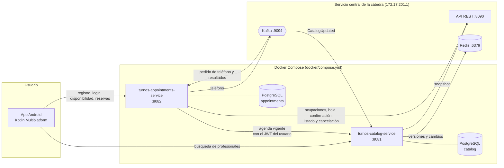

# Arquitectura

El sistema tiene una app Android y dos servicios backend independientes, cada uno con su
propia base de datos. Los dos se integran con el servicio central de la cátedra, que es
externo y se alcanza por ZeroTier.

## Qué hace cada servicio

**Catálogo** (`turnos-catalog-service`):

- Guarda una copia local de las categorías, los profesionales y sus horarios semanales.
- La mantiene al día: snapshot por REST al empezar o si se pierde el hilo, y cambios por Redis
  cuando Kafka avisa que hay una versión nueva. Además revisa cada cierto tiempo, por si se
  pierde un aviso.
- Resuelve las búsquedas y los filtros (categoría, nombre, habilitado y disponibilidad por día
  y franja) siempre sobre la copia local.
- Le da a turnos la agenda vigente de un profesional.
- No tiene usuarios: valida los JWT que emite turnos.

Detalle: [sincronizacion.md](https://github.com/Final-Programacion-II/turnos-catalog-service/blob/main/docs/sincronizacion.md)
en el repo del catálogo.

**Turnos** (`turnos-appointments-service`, este repo):

- Registra a los usuarios y emite los JWT.
- Calcula los turnos libres: la agenda vigente del catálogo, menos las ocupaciones que informa
  la cátedra.
- Lleva el proceso de reserva: hold, confirmación inicial, teléfono y resultado. Guarda cada
  paso con su dueño.
- Aplica los eventos de Kafka una sola vez y reconcilia por REST los procesos que se quedaron
  sin resultado.
- Lista y cancela las reservas de cada usuario.

Detalle: [reservas.md](reservas.md).

## Cómo se comunican

| Desde | Hacia | Cómo | Para qué |
| --- | --- | --- | --- |
| App | Turnos | REST + JWT del usuario | Registro, login, disponibilidad y reservas |
| App | Catálogo | REST + JWT del usuario | Búsqueda de profesionales |
| Turnos | Catálogo | REST, reenviando el JWT del usuario | Agenda vigente de un profesional |
| Catálogo | Cátedra | REST, Redis y Kafka, con la cuenta técnica | Snapshot, cambios y avisos de versión |
| Turnos | Cátedra | REST y Kafka, con la cuenta técnica | Ocupaciones, reservas, teléfono y resultados |

El contrato entre los dos servicios y la API para la app están en [api.md](api.md). Las
decisiones de autenticación están en [seguridad.md](seguridad.md).

## Propiedad de los datos

Cada servicio es dueño exclusivo de sus datos y de sus migraciones (Liquibase):

| Servicio | Datos | Base |
| --- | --- | --- |
| Catálogo | Copia del catálogo, versión aplicada, eventos de catálogo procesados | `catalog` |
| Turnos | Usuarios, procesos de reserva, eventos de reserva procesados | `appointments` |

- Ningún servicio lee la base del otro. En Docker, cada base está en una red interna propia, y
  desde un servicio la base del otro ni siquiera se resuelve.
- Turnos no guarda una copia del catálogo. Cada reserva conserva el nombre del profesional y
  la categoría como dato histórico, para mostrarla, pero antes de cada operación nueva se
  consulta la agenda vigente al catálogo.

El detalle de las tablas de turnos está en [modelo-datos.md](modelo-datos.md).

## Tecnologías

- Java 21, Spring Boot 4 y JHipster 9 (sin cliente web) en los dos servicios.
- PostgreSQL, una instancia por servicio, con migraciones Liquibase.
- Kafka con `spring-kafka`; Redis con Lettuce (solo el catálogo).
- Imágenes con Jib y Docker Compose para levantar el sistema.
- Tests con JUnit 5, Mockito, Testcontainers (PostgreSQL) y ArchUnit.
- App Android con Kotlin Multiplatform.

Por dentro, la lógica de reservas de turnos (`reservation`) y la sincronización del catálogo
(`sync`) siguen una arquitectura hexagonal: un dominio sin dependencias de frameworks,
puertos y adaptadores. ArchUnit lo verifica en cada build.
