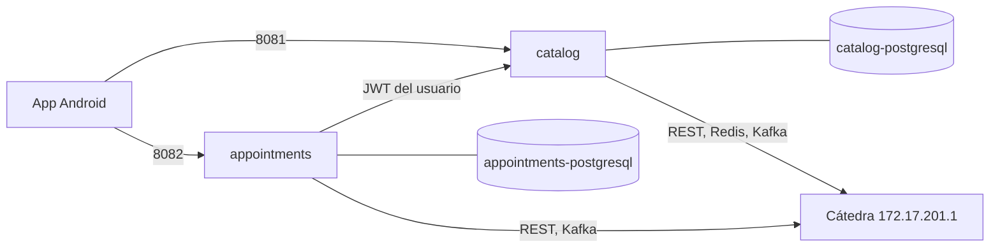

# Levantar el sistema con Docker

`docker/compose.yml` levanta los dos servicios backend y sus dos bases de datos. La cátedra
(API, Redis y Kafka) no va en Docker: es un servidor externo, y los contenedores llegan a él
por la red de ZeroTier de la máquina. La app Android corre afuera y usa los puertos 8081
(catálogo) y 8082 (turnos).



## Requisitos

- Docker con Docker Compose.
- ZeroTier conectado a la red de la cátedra.
- Los dos repos clonados: `turnos-catalog-service` y `turnos-appointments-service`.

## 1. Revisar que los contenedores lleguen a la cátedra

La cátedra está en `172.17.201.1`, dentro de `172.17.0.0/16`, el rango de la red por defecto
de Docker (`docker0`). Un contenedor en esa red cree que la cátedra está en su misma red, la
busca ahí y no la encuentra. Por eso `docker/compose.yml` no usa la red por defecto: sus redes
están en `10.42.x`, y desde ahí el tráfico sale por la máquina y toma la ruta de ZeroTier.

Para comprobarlo con una red como las del compose:

```bash
docker network create --subnet 10.42.9.0/24 prueba-catedra
docker run --rm --network prueba-catedra curlimages/curl:8.11.1 -s -o /dev/null -w "%{http_code}\n" --max-time 5 http://172.17.201.1:8090/api/student/integration
docker network rm prueba-catedra
```

Tiene que dar `401`: llega, y la cátedra pide el token. Con la red por defecto (un
`docker run` sin `--network`) da `000`, y eso es lo esperado.

Si `10.42.x` chocara con alguna red de la máquina, hay que elegir otro rango que no aparezca
en `ip route` y cambiarlo en las tres redes del compose. Ojo con las redes de ZeroTier: pueden
usar rangos `10.x` que no son obvios (probado el 6/11: en la máquina de desarrollo,
`10.200.0.0/16` y `10.201.0.0/16` son de otra red de ZeroTier).

## 2. Construir las imágenes

En cada repo, con [Jib](https://github.com/GoogleContainerTools/jib):

```bash
cd ~/Escritorio/turnos/turnos-catalog-service
./mvnw -ntp -Pprod verify jib:dockerBuild -DskipTests

cd ~/Escritorio/turnos/turnos-appointments-service
./mvnw -ntp -Pprod verify jib:dockerBuild -DskipTests
```

Quedan las imágenes `catalog:latest` y `appointments:latest`. Hay que volver a construirlas
cada vez que cambia el código.

## 3. Configurar `docker/.env`

```bash
cp docker/.env.example docker/.env
chmod 600 docker/.env
```

Completar los valores. Los de la cátedra son los mismos que ya están en el `.env` de cada
servicio. `docker/.env` está en `.gitignore`: nunca se sube.

Los dos consumer groups de Kafka tienen que ser distintos entre sí. Mientras corra Docker, no
levantar también los servicios con `./mvnw`: compartirían el consumer group y se repartirían
los mensajes.

## 4. Levantar, revisar y apagar

```bash
docker compose -f docker/compose.yml up -d
docker compose -f docker/compose.yml ps
```

Los cuatro contenedores tienen que llegar a `healthy`. El catálogo tarda un poco más la
primera vez, porque carga el snapshot de la cátedra.

```bash
docker compose -f docker/compose.yml logs -f appointments   # logs de un servicio
docker compose -f docker/compose.yml down                   # apaga, conserva los datos
docker compose -f docker/compose.yml down -v                # apaga y borra las bases
```

## Separación de datos

- Cada servicio tiene su propio contenedor de PostgreSQL, con su usuario y su contraseña.
- Cada base está en una red interna propia (`catalog-db` y `appointments-db`), a la que solo
  llega su servicio. Desde `appointments` no hay ruta hasta `catalog-postgresql`.
- Las bases no publican puertos hacia afuera. Los servicios publican solo en `127.0.0.1`.
- Los dos servicios se comunican únicamente por HTTP (`http://catalog:8081`), con el JWT del
  usuario.

Para comprobarlo:

```bash
docker compose -f docker/compose.yml exec appointments bash -c 'exec 3<>/dev/tcp/catalog-postgresql/5432 && echo LLEGA || echo NO LLEGA'
```

Tiene que decir `NO LLEGA` (o que no puede resolver el nombre).

## Salud de los servicios

El healthcheck usa `/management/health/readiness`, que revisa que la app arrancó y tiene su
base. No incluye a la cátedra a propósito: si Redis o Kafka no responden un rato, el servicio
sigue levantado, informa el problema (`GET /api/catalog/sync-status` en el catálogo, 503 en
turnos) y se recupera solo cuando vuelve.

## Problemas conocidos

**`cannot stop container: permission denied`** al recrear un contenedor (por ejemplo, con
`up -d --force-recreate` después de reconstruir una imagen). Pasa con Docker instalado como
snap en Ubuntu: AppArmor no le deja al motor de Docker mandarle la señal de parada al
contenedor. Se resuelve parando el proceso como administrador y volviendo a levantar:

```bash
PID=$(docker inspect -f '{{.State.Pid}}' turnos-sistema-appointments-1)
sudo kill $PID
docker compose -f docker/compose.yml up -d appointments
```

Es la misma señal que manda `docker stop`, así que el servicio se apaga ordenadamente. Si el
contenedor queda en `Created`, el `up -d` lo arranca.

## Prueba (6/11)

- Los cuatro contenedores quedaron `healthy` en menos de un minuto.
- El catálogo cargó el snapshot de la cátedra en su base nueva y aceptó el JWT emitido por
  turnos.
- Reserva completa desde Docker (Romina Acosta, 10/11, 13:00): pedido de teléfono por Kafka →
  `PHONE_SUBMITTED` → `CONFIRMED`.
- Desde el contenedor de turnos, `catalog-postgresql` ni siquiera se resuelve: no hay ruta a
  la base del otro servicio.
