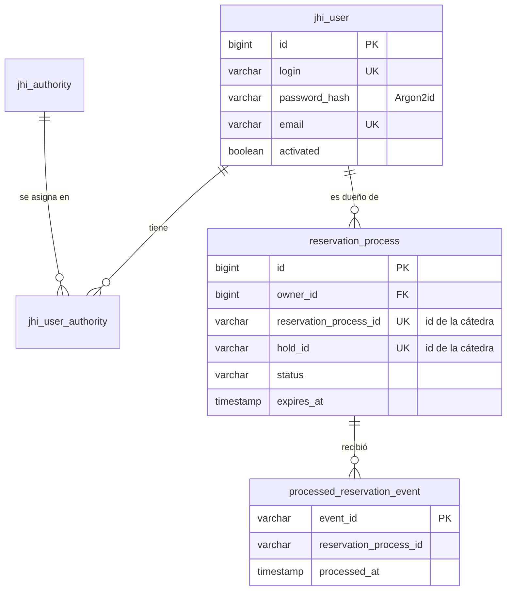

# Modelo de datos

La base `appointments` es de turnos y de nadie más. La crea y la modifica Liquibase, con los
changelogs de `src/main/resources/config/liquibase`.

## Usuarios (JHipster)

| Tabla | Para qué |
| --- | --- |
| `jhi_user` | Usuarios de la app: login, hash de la contraseña (Argon2id), nombre, email, idioma y si está activo |
| `jhi_authority` | Roles: `ROLE_USER` y `ROLE_ADMIN` |
| `jhi_user_authority` | Qué roles tiene cada usuario |

Al registrarse, el usuario queda activo y con `ROLE_USER`. En producción, los usuarios de
ejemplo de JHipster (`admin` y `user`) están desactivados (ver [seguridad.md](seguridad.md)).

## `reservation_process`

Un proceso de reserva por cada hold que se pide a la cátedra, desde el hold hasta su resultado.

| Columna | Qué guarda |
| --- | --- |
| `id` | Id propio. Es el que usa la app (`/api/reservations/{id}`). |
| `owner_id` | Usuario dueño (FK a `jhi_user`). Sale del JWT, nunca del pedido. Tiene índice, porque el listado filtra por dueño. |
| `professional_id`, `professional_external_id` | Id del profesional en el catálogo y en la cátedra |
| `professional_name`, `category_name` | Foto del momento de la reserva, para mostrarla. **No** es el catálogo vigente. |
| `appointment_date`, `start_time`, `end_time` | El turno. Las horas son de reloj del consultorio, sin zona horaria. |
| `external_patient_id` | Cómo se identifica al usuario ante la cátedra: `user-{id}` |
| `patient_first_name`, `patient_last_name` | Paciente informado a la cátedra |
| `hold_id`, `reservation_process_id` | Ids de la cátedra. Únicos: un hold no puede quedar en dos procesos. |
| `status` | Estado local: `HELD`, `WAITING_FOR_PHONE`, `PHONE_SUBMITTED`, `CONFIRMED`, `CANCELLED`, `EXPIRED`, `INVALID` o `FAILED` |
| `expires_at` | Vencimiento informado por la cátedra (UTC) |
| `request_event_id` | `eventId` del pedido de teléfono. Se devuelve junto con el teléfono. |
| `phone_number` | Teléfono enviado, ya normalizado |
| `reservation_id` | Id de la reserva en la cátedra, cuando se confirma |
| `status_reason` | Motivo del último cambio (por ejemplo `HOLD_EXPIRED`, o el mensaje de un rechazo) |
| `created_at`, `updated_at` | Auditoría (UTC) |

Las transiciones de estado están en [reservas.md](reservas.md).

## `processed_reservation_event`

Los eventos de Kafka que ya se aplicaron. La clave primaria es el `eventId`: el mismo evento
no puede registrarse dos veces. Se guarda en la misma transacción que el cambio de estado.

`reservation_process_id` relaciona el evento con su proceso. No tiene FK a propósito: un evento
de un proceso que no existe acá no se registra, y la tabla solo sirve para reconocer
repetidos.

## Lo que este servicio no guarda

- **El catálogo.** Las categorías, los profesionales y los horarios son del servicio de
  catálogo. Turnos los consulta por REST cada vez que los necesita.
- **Las ocupaciones de la agenda.** Cambian todo el tiempo, así que se piden a la cátedra en
  cada consulta de disponibilidad.
- **Credenciales de la cátedra.** El JWT técnico va solo en variables de entorno.
