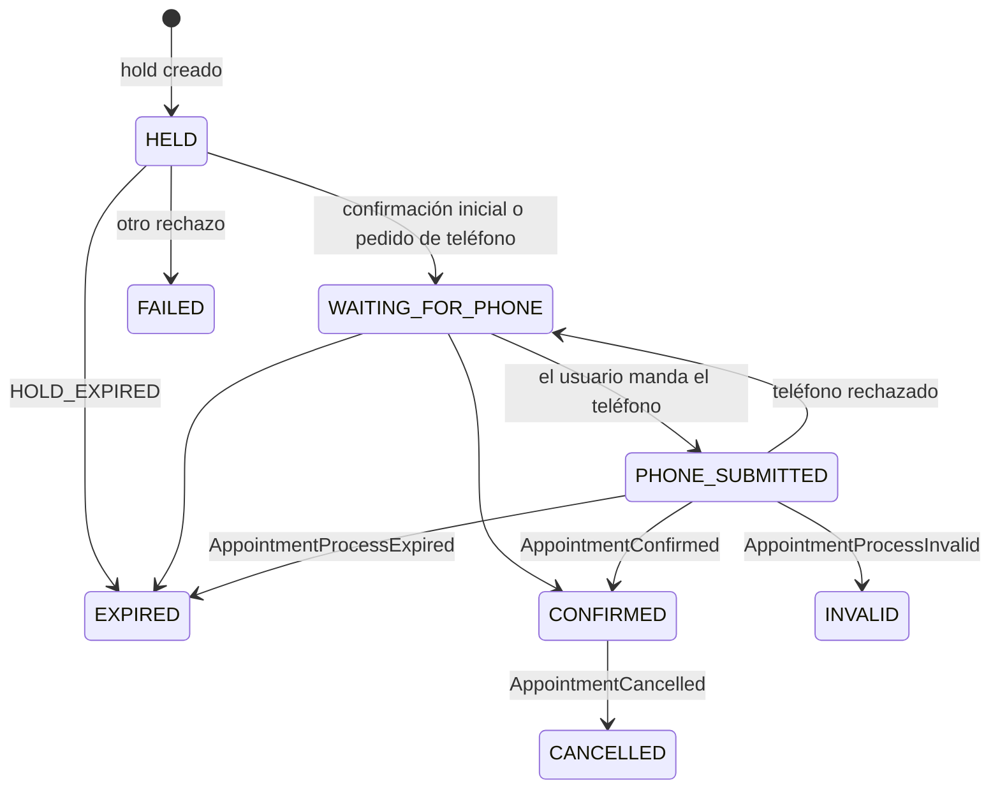

# Proceso de reserva

Reservar un turno no es una sola llamada: la cátedra primero retiene el turno, después
pide un teléfono por Kafka y recién ahí confirma. El servicio de turnos guarda cada paso
en la tabla `reservation_process`, así el usuario puede ver en qué quedó su reserva y
nada se pierde si algo falla en el medio.

## Cómo empieza

`POST /api/reservations` con el profesional, la fecha, la hora y el nombre del paciente:

1. Se calcula la disponibilidad con la agenda vigente del catálogo y las ocupaciones de
   la cátedra. Si el turno no está libre, se responde 409 `SLOT_NOT_AVAILABLE` y no se
   llama a la cátedra.
2. Se pide el hold a la cátedra. Si lo rechaza (por ejemplo, otro lo tomó recién), se
   devuelve el mismo status y el mismo `code` que mandó la cátedra, y no se guarda nada.
3. Se guarda el proceso como `HELD`, con los ids que dio la cátedra.
4. Se hace la confirmación inicial. Si sale bien, el proceso pasa a `WAITING_FOR_PHONE`.

Se guarda antes de confirmar a propósito: la confirmación hace que la cátedra publique
el pedido de teléfono, y ese evento puede llegar por Kafka antes que la respuesta REST.
Así, cuando llega, ya hay un proceso al que aplicárselo.

## Estados

`HELD`, `WAITING_FOR_PHONE` y `PHONE_SUBMITTED` son estados abiertos. Los demás son
resultados, y un resultado no se reabre: si llega un aviso tardío o repetido, se ignora.
La única salida de un resultado es cancelar una reserva `CONFIRMED`.

Las reglas están en `ReservationProcess` (dominio) y tienen sus propios tests.

## Cuando la cátedra no responde

Un timeout no dice si la operación se hizo o no (sección 18.4 de la referencia).

| Paso | Qué pasa si la cátedra no responde |
| --- | --- |
| Hold | 503 `CATEDRA_UNAVAILABLE` y no se guarda nada. Si el hold sí se creó, vence solo en unos minutos; mientras tanto ese turno da `SLOT_ALREADY_HELD`. |
| Confirmación inicial | El proceso queda `HELD` y se responde 201 igual. La app puede reintentar con `POST /api/reservations/{id}/confirm`. |
| Reintento de la confirmación | Si la primera sí había llegado, la cátedra responde `RESERVATION_PROCESS_ALREADY_CONFIRMED` y el proceso avanza igual a `WAITING_FOR_PHONE`. |

El reintento lo pide el usuario: no hay reintentos automáticos que puedan quedar en un
ciclo sin fin.

## Respuestas que llegan juntas

Una respuesta REST y un evento Kafka pueden querer cambiar el mismo proceso al mismo
tiempo. Para que no se pisen, cada cambio lee el proceso con `SELECT ... FOR UPDATE`, le
aplica la regla y lo guarda en la misma transacción. El que llega segundo espera y ve el
estado que dejó el primero.

Las llamadas a la cátedra se hacen fuera de esas transacciones: una cátedra lenta no deja
registros bloqueados.

## Quién ve cada reserva

El dueño sale siempre del JWT (claim `userId`), nunca del body. Un usuario que pide una
reserva ajena recibe 404 `RESERVATION_NOT_FOUND`, lo mismo que si no existiera, para no
revelar qué ids existen.

A la cátedra se le manda `externalPatientId = "user-{id}"`, armado con el id interno del
usuario, que no cambia aunque cambie su login o su email.

## Endpoints

| Método | Ruta | Qué hace |
| --- | --- | --- |
| POST | `/api/reservations` | Empieza una reserva (hold + confirmación inicial) |
| GET | `/api/reservations/{id}` | Estado de una reserva propia |
| POST | `/api/reservations/{id}/confirm` | Reintenta la confirmación inicial si quedó `HELD` |

## Prueba contra la cátedra (2/11)

Con Romina Acosta (id local 1068, id de la cátedra 218), martes 3/11 a las 13:00:

- La reserva se creó con 201 y quedó `WAITING_FOR_PHONE`, con 10 minutos de vigencia.
- Consultada por su dueño, respondió 200. Consultada por otro usuario, 404 `RESERVATION_NOT_FOUND`.
- Pedir el mismo turno otra vez dio 409 `SLOT_ALREADY_HELD`: lo rechazó la cátedra y no se
  guardó nada.
- **Hallazgo:** con el proceso en `WAITING_FOR_PHONE` y el hold vigente,
  `GET /api/appointment-occupancies` devolvió la lista vacía. Por eso la disponibilidad
  siguió mostrando las 13:00 como libres. El turno no se puede tomar dos veces, porque la
  cátedra rechaza el segundo hold, pero el usuario se entera recién al intentar reservarlo.
  Se consultó a la cátedra si es el comportamiento esperado.

## Pendiente

- Pedido de teléfono, envío y resultados por Kafka.
- Listado de reservas propias y cancelación.
- Revisar al arrancar los procesos abiertos que ya vencieron.
